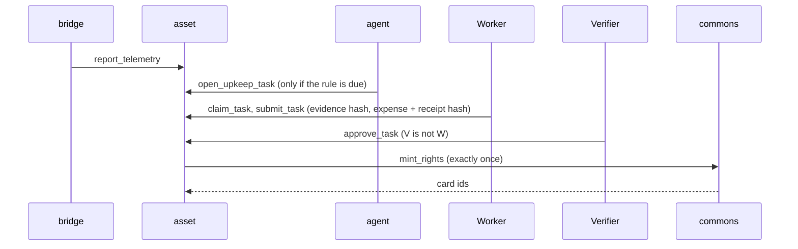

# COMMONKIT

**Shared things that pay for their own upkeep — and open up to the people who keep them alive.**

Fix it, refill it, clean it, check it, teach it — every kind of care that keeps a shared thing alive earns access to it.

> Today a shared machine's money and rules live in one admin's spreadsheet. On COMMONKIT they live in the machine's own keyless NEAR account: no one can drain it, and no one can take back what you earned.
>
> *Precisely:* no method deletes, downgrades or transfers a usage-right card once granted. The DAO can still make a card unusable in practice — by deactivating the asset, moving it to another group, or adding a credential requirement — and that limit is listed under "Security model and honest limits".

Built at NEAR HACKATHON 2026 · Track: **Social Money** · NEAR **testnet** only. Every claim below links to a testnet tx, a test or a file. Devices are emulated or simulated and labelled SIMULATED; no physical device has been tested yet.

## Try it in 2 minutes

*The hosted app is not deployed yet (HUMAN TODO H11 in [`docs/STATUS.md`](docs/STATUS.md)); `<domain>` is a placeholder until it is.*

- Do **open `https://<domain>/app`** (no wallet) → see the board with the four testnet assets, each with the SIMULATED badge, their floats vs caps and upkeep tasks.
- Do **open `https://<domain>/app/proof`** → see the account keys, the shared `code_hash`, the ledger invariants and the DAO proposals, with explorer links.
- Do **run `./scripts/simulate.sh washer`** in a clean clone → see the whole loop on a private local NEAR sandbox with the real contracts, bridge and agent, every step line prefixed `[SIMULATED]` and the summary headed SIMULATED (all 12 profiles: [`evidence/simulate-all-2026-11-10.txt`](evidence/simulate-all-2026-11-10.txt)).
- Do **open any tx link below** → see it on the NearBlocks testnet explorer.

## The five core steps (testnet)

From [`evidence/steps.json`](evidence/steps.json) (`core: true`); the full table follows.

1. **Reserve → bridge access.** Do: Ali reserves 2 printer slots (fee 0.5 NEAR + refundable deposit 2 NEAR), then asks the bridge for access with a NEP-413 signed request → See: reservation Confirmed [`3hHS1wra…`](https://testnet.nearblocks.io/txns/3hHS1wra65mLrgztB94qVNeLiUsLzNRvkfK3CbBzp6Qz); the bridge records the session on chain *before* it unlocks [`ARRc2y3M…`](https://testnet.nearblocks.io/txns/ARRc2y3M1WwSKcCfcCkp7PpmMDBGBrqWoJ3zkTNMmKwz) and the emulated Moonraker starts the print (SIMULATED). Steps 2–3.
2. **Access without a reservation is refused.** Do: Can, who has no reservation, asks the bridge for access → See: `can_access` returns `not_holder`, the bridge answers 403 and the emulated printer stays idle. No transaction by design: the refusal happens before anything is written. Step 4.
3. **Upkeep task → independent approval → rights.** Do: telemetry crosses the `nozzle_clean` threshold; the agent opens the task; Ayşe claims and submits; the bridge runs a calibration print; Mehmet approves → See: `task_opened` by the agent [`AbQSVeSa…`](https://testnet.nearblocks.io/txns/AbQSVeSayT76JeE4jikELhUUs3QEEmaqMjrmYHQrAvem); claim [`GZfCTLk4…`](https://testnet.nearblocks.io/txns/GZfCTLk4VvcijK7BfSMwmFYYCpRfmwXZ3LdsNvEjXMJ1), submit [`ChE95bYQ…`](https://testnet.nearblocks.io/txns/ChE95bYQJJWomAfU4PxxbtMADQ6VajRhwxtwkTyTXzqp), verification [`5RAh6R1w…`](https://testnet.nearblocks.io/txns/5RAh6R1wsw7SKYN4sv6XMLmQdRjZ67KAmNgsoEQWD6rr); approval with `nft_mint` of right-3 and right-4 to Ayşe [`Gr7bwqmC…`](https://testnet.nearblocks.io/txns/Gr7bwqmCWqTzxqa4fSrmNHdZyexyar2eAoSidRfrPhQx). Steps 7–8.
4. **Excess float is swept to the DAO.** Do: Ali books more printer time, so the fee pushes the float over its 3 NEAR cap → See: `swept` 0.0499 NEAR in the same tx; float back at the cap; DAO treasury 5.6511 → 5.701 NEAR [`DBTLyXkr…`](https://testnet.nearblocks.io/txns/DBTLyXkrBuovZTd6xyc9Ys3WnfBuHfiLgfEqJJquC31S). Step 6.
5. **Verify everything yourself.** Do: `./scripts/verify.sh` (read-only, no keys) → See: exit 0 and no ❌ across keys, code hashes, ledger invariants, sweeps, rights ↔ tasks, escalations, reimbursement caps, the out-of-service log and all evidence steps ([`evidence/verify-step21.txt`](evidence/verify-step21.txt)). Step 21.

## What we built during the hackathon

- **Two Rust contracts** — `asset` (one per shared thing, same WASM everywhere) and `commons` (roles, credentials, non-transferable NEP-171 cards) — per [`docs/CONTRACT_SPEC.md`](docs/CONTRACT_SPEC.md). `pnpm test:contracts` passed on the lead's rerun of 2026-11-10: 402 unit tests (279 asset, 120 commons, 3 types) and 36 near-workspaces sandbox tests (20 invariant tests in [`contracts/tests/tests/invariants.rs`](contracts/tests/tests/invariants.rs), 5 DAO flows, 3 verifier-fix checks, 3 coverage checks, gas, storage, private callbacks, smoke, wiring) against the real Sputnik DAO v2 WASM ([`contracts/tests/res/SOURCE.md`](contracts/tests/res/SOURCE.md)); full output: [`evidence/ci-local/test-contracts-2026-11-10.txt`](evidence/ci-local/test-contracts-2026-11-10.txt).
- **Two unmodified Sputnik DAO v2 DAOs** from the testnet factory: `makerlab-ck.sputnikv2.testnet` [`FjQhBmLT…`](https://testnet.nearblocks.io/txns/FjQhBmLT7oJa7nbNjuoxtQ6rff1jmV7RfVahBUvPmBhb) and `dorm-b-ck.sputnikv2.testnet` [`7FEEhTWm…`](https://testnet.nearblocks.io/txns/7FEEhTWmfQrhpicfGCz4TiPEKwNNeXDUWegUXxb9HK2D).
- **Two commons and four asset accounts, keyless.** Deploys: commons [`GSpazbSo…`](https://testnet.nearblocks.io/txns/GSpazbSoUiN5UtbStM5cbRc89VdjjXpvH4P2xDk2vuk8) / [`8BqTEpT2…`](https://testnet.nearblocks.io/txns/8BqTEpT2NmisQwGUXmmCAF2UCboiiADGqUmKG8Qw7ggw); `printer-01` [`315qJKEZ…`](https://testnet.nearblocks.io/txns/315qJKEZC1TcrG8q9BAMcdDEew3ZfWXNzcxXDkPmEJwU), `laser-01` [`CjEyTuGY…`](https://testnet.nearblocks.io/txns/CjEyTuGYMUgZBR6wWzZVHFhtejKvAk3c8c4esjy6uKYF), `washer-01` [`8bDy3oxZ…`](https://testnet.nearblocks.io/txns/8bDy3oxZhrTvac1dW3PNB8GJGShkfaJpLCeri4xWbiBS), `fridge-01` [`Djix1a22…`](https://testnet.nearblocks.io/txns/Djix1a22wMz1ZD3xJs6W3L1yyDFi9Uu6T79AB8MvULPm). Full-access keys deleted: [`7rxMTZ3k…`](https://testnet.nearblocks.io/txns/7rxMTZ3k9BpHVeVKHTmK9Nr2s6JtWvEK4nJoGQLyog7X) [`3qmAWFX7…`](https://testnet.nearblocks.io/txns/3qmAWFX7C9GoV2Jk2mRZjLYo2dhKoP31g6Jo1qQQmbMg) [`Bf6gbxyT…`](https://testnet.nearblocks.io/txns/Bf6gbxyTuguCeP4qm6ZDj4Mekmuhhbyi4nRzTb517EK3) [`BXJTZ5Rc…`](https://testnet.nearblocks.io/txns/BXJTZ5RczfieprUA1s4GSM5E694Qzc5RNxL3EWgiW2Jd) [`HEfVWQF8…`](https://testnet.nearblocks.io/txns/HEfVWQF8uNvtKoNNHHcn3kdkU1zNqCWxU4nHHxf9pT5D) [`CMExFncD…`](https://testnet.nearblocks.io/txns/CMExFncD6yjKEzZPf4tXPTSFUEWQHuSoEAqXnVC9GKyd); `verify.sh` shows 0 access keys on all eight contract accounts (the two DAOs included) and one asset `code_hash` `3RpdWfB6MRHyL5wb5ZVFGoKWFLo3uXyDpp592Xdp9g2h` ([`evidence/verify-2026-11-10.txt`](evidence/verify-2026-11-10.txt)).
- **Bridge** (TypeScript, Fastify): NEP-413 access checks with full-access keys only (D-019), the chain write before the unlock (D-404), `moonraker` and `smart_plug` adapters running against device emulators (steps 3, 8, 13), the simulator (steps 15, 19, 20). [`bridge/`](bridge)
- **Operations agent** (TypeScript): opens upkeep tasks only when `get_rule_status` says due, escalates purchases as Sputnik proposals the asset contract opens itself (step 10, [`4vcji9GS…`](https://testnet.nearblocks.io/txns/4vcji9GSXnsZcSwhN74r1raEnRZXVnEVUpPFHeCYh3Df)); the contract refused all its out-of-bounds attempts on testnet ([`evidence/agent-limits.json`](evidence/agent-limits.json), step 16). Rationale comes from templates; no LLM rationale is claimed (D-107). [`agent/`](agent)
- **`simulate.sh`**: the whole loop for all 12 profiles on a private local NEAR sandbox with the real contracts, real Sputnik WASM, real bridge and agent: 12/12 PASS, one shared `code_hash` ([`evidence/simulate-all-2026-11-10.txt`](evidence/simulate-all-2026-11-10.txt), D-420).
- **Web app** under `/app` and a landing page at `/` ([`web/`](web), [`landing/`](landing), D-025); hosting pending (H11).

All tx links per step: [`evidence/EVIDENCE.md`](evidence/EVIDENCE.md).

## The loop



Full diagrams: [`docs/ARCHITECTURE.md`](docs/ARCHITECTURE.md) §4.

## Scenarios

12 asset profiles, one contract ([`docs/PROFILES.md`](docs/PROFILES.md), `profiles/*.json`), grouped by upkeep kind; a profile appears under every kind it uses. **Status** is `meta.status` from each profile file. Every profile also passes `./scripts/simulate.sh <asset_type>` on a local sandbox ([`evidence/simulate-all-2026-11-10.txt`](evidence/simulate-all-2026-11-10.txt)).

| Upkeep kind | Profile: rule (trigger) | Device path | Status | Testnet evidence |
| :--- | :--- | :--- | :--- | :--- |
| Maintenance | printer-01 (printer_3d): `nozzle_clean` (Metric), `bed_level` (Metric) | moonraker adapter → emulated Moonraker | simulation | steps 7–8, 16 |
| Maintenance | laser-01 (laser_cutter): `lens_clean` (Metric) | smart_plug adapter → emulated Shelly | simulation | — |
| Maintenance | washer-01 (washer): `descale` (Metric) | simulator | simulation | — |
| Maintenance | gpu_server: `driver_update` (Schedule) · tractor: `oil_change` (Metric) | simulator | profile example only | — |
| Restock | printer-01: `filament_spool` (Metric, receipt ≤ 0.5 NEAR) | moonraker adapter → emulated Moonraker | simulation | step 18 |
| Restock | washer-01: `detergent` (Metric, receipt ≤ 0.3 NEAR) | simulator | simulation | — |
| Restock | emergency_generator: `fuel_refill` (Metric, receipt ≤ 1 NEAR) | simulator | profile example only | — |
| Cleaning | washer-01: `filter_clean` (Metric) | simulator | simulation | step 16 |
| Cleaning | fridge-01 (community_fridge): `weekly_clean` (Schedule) | simulator | simulation | step 20 |
| Cleaning | gpu_server: `dust_clean` · tractor: `pump_filter_clean` (Schedule) · microscope: `clean_inventory` · rehearsal_room: `room_clean` | simulator | profile example only | — |
| Inspection | laser-01: `monthly_safety_check` (Schedule) · fridge-01: `temperature_check` (Metric) | emulated Shelly · simulator | simulation | — |
| Inspection | ev_charger: `cable_check` · cargo_bike: `brake_check`, `tire_check` · emergency_generator: `monthly_test_run` (Schedule) · tool_library_ladder: `safety_inspection` | simulator | profile example only | — |
| Repair | printer-01: `fault_repair` (Report) | moonraker adapter → emulated Moonraker | simulation | — |
| Repair | washer-01: `fault_repair` (Report) | simulator | simulation | step 19 |
| Repair | rehearsal_room: `fault_repair` (Report, 2 reports) | simulator | profile example only | — |
| Rebalance | cargo_bike: `return_home` (Report, 2 reports) | simulator | profile example only | — |
| Supervision | rehearsal_room: `evening_supervision` (Schedule) | simulator | profile example only | — |
| Teaching (credential flow, not a rule) | laser-01 `laser_safety` | emulated Shelly | simulation | steps 11–13 |

Profiles whose adapter the bridge does not have (OCPP, smart lock, API gateway, `manual_qr` loans) run on the simulator in `simulate.sh` (D-420).

## Simulation and emulators

Everything shown so far is simulated or emulated, and labelled so (D-022):
- `printer-01` and `laser-01` go through the bridge's real `moonraker` and `smart_plug` adapters against local device emulators that implement the documented API subset; the laser's load is an emulated 60 W lamp-class stand-in, so nothing is energised (steps 3, 8, 13).
- `washer-01` and `fridge-01` use the simulator; its reports put `simulated = 1` into on-chain telemetry (step 15, D-401).
- `simulate.sh` runs on a private local sandbox, not on testnet; `--fake` runs bridge and agent on in-memory fake chains and says on every line that the contracts are not exercised (D-420).

**Demo overrides on testnet** — lowered thresholds and limits so the demo fits in minutes, each applied by a DAO `set_profile` (or `set_operators`) proposal and restored where the step says so ([`evidence/demo-overrides.json`](evidence/demo-overrides.json)):

| Step | Kind | Asset | Field | Value set | Production value | Live now? | DAO proposal | Executing vote |
| :--- | :--- | :--- | :--- | :--- | :--- | :--- | :--- | :--- |
| 1 | override | printer-01 | `nozzle_clean` | 1800 | 720000 | **yes** | `makerlab-ck.sputnikv2.testnet#9` | [`At6SwzzV…`](https://testnet.nearblocks.io/txns/At6SwzzVjEkRSJ9rBsh2ejsAKsZsfMvBCzVLwHTG2RBA) |
| 16 | override | washer-01 | `filter_clean` | 1 | 30 | no (restored) | `dorm-b-ck.sputnikv2.testnet#10` | [`nqMmhGWQ…`](https://testnet.nearblocks.io/txns/nqMmhGWQYc3kELyxrCYLuV7QMEHFHxTsdiSeQ1pb3Rw) |
| 16 | override | washer-01 | `period_reward_quota` | 2 | 12 | no (restored) | `dorm-b-ck.sputnikv2.testnet#10` | [`nqMmhGWQ…`](https://testnet.nearblocks.io/txns/nqMmhGWQYc3kELyxrCYLuV7QMEHFHxTsdiSeQ1pb3Rw) |
| 16 | override | printer-01 | `bed_level` | 1 | 50 | no (restored) | `makerlab-ck.sputnikv2.testnet#12` | [`G8Vb1fTc…`](https://testnet.nearblocks.io/txns/G8Vb1fTc68YzosfME5TMnM79rWALkr46mWFTj5FNFZsF) |
| 16 | override | laser-01 | `agent_id` | null | agent.commonkit-sxflo.testnet | no (restored) | `makerlab-ck.sputnikv2.testnet#13` | [`621S7Ry7…`](https://testnet.nearblocks.io/txns/621S7Ry755JdfH91J84bSrmnYKLKBBiBJrgGPKdgAaQQ) |
| 16 | restore | laser-01 | `agent_id` | agent.commonkit-sxflo.testnet | agent.commonkit-sxflo.testnet | — | `makerlab-ck.sputnikv2.testnet#14` | [`8gn7Tw8b…`](https://testnet.nearblocks.io/txns/8gn7Tw8bfiFzjbpZUNeLHJowMWvg69E4hcQ5sP1Mw6i4) |
| 16 | restore | washer-01 | `filter_clean` | 30 | 30 | — | `dorm-b-ck.sputnikv2.testnet#11` | [`2tbnLVXm…`](https://testnet.nearblocks.io/txns/2tbnLVXm3ScknKJfyzpf82Lz72RsVZgbMSGgCuDmG2Gi) |
| 16 | restore | washer-01 | `period_reward_quota` | 12 | 12 | — | `dorm-b-ck.sputnikv2.testnet#11` | [`2tbnLVXm…`](https://testnet.nearblocks.io/txns/2tbnLVXm3ScknKJfyzpf82Lz72RsVZgbMSGgCuDmG2Gi) |
| 16 | restore | printer-01 | `bed_level` | 50 | 50 | — | `makerlab-ck.sputnikv2.testnet#15` | [`DPWHpngq…`](https://testnet.nearblocks.io/txns/DPWHpngqR1KXoKik1GYqMEdCuyivVHtMq6rTvbgDSAL1) |
| 18 | override | printer-01 | `filament_spool` | 5000 | 330000 | **yes** | `makerlab-ck.sputnikv2.testnet#16` | [`FNT5MNsm…`](https://testnet.nearblocks.io/txns/FNT5MNsmA4q899unZkwQV1wktcF78hGPgWtJqjbRB4KV) |
| 20 | override | fridge-01 | `weekly_clean` | 1h | 168h | **yes** | `dorm-b-ck.sputnikv2.testnet#12` | [`7uKxVanU…`](https://testnet.nearblocks.io/txns/7uKxVanUsqUzdKnJMyDEG7xib4PA6YNia8dWqxf5BqM7) |

One off-chain override: in step 10 the agent's purchase hint uses `after_n = 1` instead of the profile's 2, so one rewarded nozzle task triggers the nozzle-kit proposal ([`evidence/steps.json`](evidence/steps.json), step 10 notes).

## Pilot

**Pending (D-024).** A real-users pilot on a real shared item with the `manual_qr` adapter (targets: ≥ 5 people with their own testnet accounts, ≥ 10 reservations, ≥ 1 upkeep task approved by another member, ≥ 1 steward-confirmed return) and one real smart plug powering a desk-lamp stand-in are planned and wait on the human (H1, H2). Plan and runbook: [`docs/PILOT.md`](docs/PILOT.md), [`pilot/RUNBOOK.md`](pilot/RUNBOOK.md). No pilot numbers exist yet. If the pilot does not happen, this section will say so; if it does, it will give the real numbers with tx links.

## Judge flow (21 steps, all passed on testnet)

Run any step with `pnpm demo:step N`; device steps use the emulators or the simulator. Tx column: the transactions with events or the expected refusal; every tx of every step is in [`evidence/EVIDENCE.md`](evidence/EVIDENCE.md). Script: [`docs/DEMO_SCRIPT.md`](docs/DEMO_SCRIPT.md) §2.

| # | Do | See | Tx (testnet) | Run |
| :--- | :--- | :--- | :--- | :--- |
| 1 | DAO proposal registers printer-01, sets its profile and funds its float | `register_asset` and `set_profile` proposals approved; float 2 NEAR (cap 3); demo override `nozzle_clean` 1 800 s labelled | [`BnQTJSQM…`](https://testnet.nearblocks.io/txns/BnQTJSQMZxFrVFzbHg5bUGzTNNxfHseR8QnPHsGnHogD) · [`At6SwzzV…`](https://testnet.nearblocks.io/txns/At6SwzzVjEkRSJ9rBsh2ejsAKsZsfMvBCzVLwHTG2RBA) · [`3PC2DYqH…`](https://testnet.nearblocks.io/txns/3PC2DYqHLS8259wSAkipxtDZh43L37gBRHxYhm5WztvT) · 7 tx in total | `pnpm demo:step 1` |
| 2 | Ali reserves 2 printer slots and pays fee + refundable deposit | Reservation Confirmed; fee 0.5 NEAR to the float, deposit 2 NEAR held as a liability | [`3hHS1wra…`](https://testnet.nearblocks.io/txns/3hHS1wra65mLrgztB94qVNeLiUsLzNRvkfK3CbBzp6Qz) | `pnpm demo:step 2` |
| 3 | Ali requests access via the bridge (NEP-413 signed); the emulated printer starts the job (SIMULATED) | Bridge 200; `mark_session_started` on chain before the unlock; the emulated Moonraker prints (SIMULATED) | [`ARRc2y3M…`](https://testnet.nearblocks.io/txns/ARRc2y3M1WwSKcCfcCkp7PpmMDBGBrqWoJ3zkTNMmKwz) | `pnpm demo:step 3` |
| 4 | Can (no reservation) requests printer access via the bridge and is refused (SIMULATED, negative) | `can_access` → `not_holder`; bridge 403; emulated printer stays `standby`; no on-chain change | no tx by design (bridge refuses before any transaction) | `pnpm demo:step 4` |
| 5 | Session finishes; the steward confirms a clean return and the deposit is refunded (SIMULATED) | Steward confirms a clean return; Refund op Succeeded (2 NEAR); reservation Closed | [`B55Q3hhR…`](https://testnet.nearblocks.io/txns/B55Q3hhRygX1aqQxN5BHrPca6BSVUJXHR8Sq9c4rUiSk) · [`597JnHej…`](https://testnet.nearblocks.io/txns/597JnHejCidKsZtmQjwvYwptHQDqCKrUG9fMnRwAZjUZ) | `pnpm demo:step 5` |
| 6 | More fees push the printer float over its cap; the excess is swept to the DAO treasury | `swept` 0.0499 NEAR; float = cap 3 NEAR; DAO treasury 5.6511 → 5.701 NEAR | [`DBTLyXkr…`](https://testnet.nearblocks.io/txns/DBTLyXkrBuovZTd6xyc9Ys3WnfBuHfiLgfEqJJquC31S) | `pnpm demo:step 6` |
| 7 | Telemetry crossed nozzle_clean; the agent opens the upkeep task with a rationale (SIMULATED) | `task_opened` (Maintenance, Metric `nozzle_seconds` 15 600 ≥ 1 800), opened by the agent, not manual | [`AbQSVeSa…`](https://testnet.nearblocks.io/txns/AbQSVeSayT76JeE4jikELhUUs3QEEmaqMjrmYHQrAvem) | `pnpm demo:step 7` |
| 8 | Ayşe claims and submits; the bridge runs a calibration print; Mehmet approves; 2 rights minted (SIMULATED) | Calibration print on the emulated Moonraker passes; Mehmet approves; `nft_mint` right-3, right-4 | [`GZfCTLk4…`](https://testnet.nearblocks.io/txns/GZfCTLk4VvcijK7BfSMwmFYYCpRfmwXZ3LdsNvEjXMJ1) · [`ChE95bYQ…`](https://testnet.nearblocks.io/txns/ChE95bYQJJWomAfU4PxxbtMADQ6VajRhwxtwkTyTXzqp) · [`Gr7bwqmC…`](https://testnet.nearblocks.io/txns/Gr7bwqmCWqTzxqa4fSrmNHdZyexyar2eAoSidRfrPhQx) · 4 tx in total | `pnpm demo:step 8` |
| 9 | Ayşe reserves the printer with an earned right (no fee) and prints on the emulated printer (SIMULATED) | Fee 0; right Locked → Consumed after the session; deposit refunded | [`5HGbP8ji…`](https://testnet.nearblocks.io/txns/5HGbP8ji8pyb53vJdCqhWWJzoVGpVDynx1v11HKouyD6) · [`7Ze39MQy…`](https://testnet.nearblocks.io/txns/7Ze39MQyQ3SDJJk92QAjoRY9Ur5XD6YSRRCwMcStgJNk) · [`7A414Bdk…`](https://testnet.nearblocks.io/txns/7A414BdkYUzcP7LJbGtdajXCDSHE9WyRLfpFnzER6G9s) · 4 tx in total | `pnpm demo:step 9` |
| 10 | Agent escalates a nozzle kit purchase; the printer contract opens a Sputnik Transfer proposal; the council approves; the DAO pays the supplier | Sputnik Transfer proposal created by `printer-01` itself; council approves; supplier paid 4 NEAR by the DAO | [`7km7HAcH…`](https://testnet.nearblocks.io/txns/7km7HAcHZq42qNp9C4K1E2SvCbyeEW5fzpU7Gw6K1nAN) · [`4vcji9GS…`](https://testnet.nearblocks.io/txns/4vcji9GSXnsZcSwhN74r1raEnRZXVnEVUpPFHeCYh3Df) · [`HMvXQbeE…`](https://testnet.nearblocks.io/txns/HMvXQbeEK659LDKgNsHk2ySW5ZopAMAGo7ZYzCQKvfip) · 5 tx in total | `pnpm demo:step 10` |
| 11 | Zeynep reserves the laser without the laser_safety credential: rejected, refunded (negative) | `reservation_rejected` reason `E_CREDENTIAL_MISSING`; refund op Succeeded | [`DWyA3hq1…`](https://testnet.nearblocks.io/txns/DWyA3hq1TyJwyafuZGVr3CmfagmpBMokLeYMLyji2Es3) reservation_rejected | `pnpm demo:step 11` |
| 12 | Ayşe proposes Zeynep’s laser training; Mehmet approves; Zeynep gets laser_safety, Ayşe a laser-group right | Training approved by a third member; Zeynep gets `laser_safety`, Ayşe 1 laser-group right | [`B2CwNMwt…`](https://testnet.nearblocks.io/txns/B2CwNMwtPHc84ytpJUSvJQwYNnsMauMCpPBdjXmnXjFG) · [`6wdSrqts…`](https://testnet.nearblocks.io/txns/6wdSrqtsVq4Ri3pWsGMgyJ8KAPp6CD5JXewDZTPLnBeM) | `pnpm demo:step 12` |
| 13 | Zeynep (now credentialed) reserves the laser; the bridge switches the emulated Shelly on, then off (SIMULATED) | Credential authorizes the booking; emulated Shelly ON (60 W lamp-class stand-in) then OFF (SIMULATED) | [`BA6f822e…`](https://testnet.nearblocks.io/txns/BA6f822ewK4NNpa5vmQJ6ANgGP9gWo252zSbHzkk99pV) · [`HF8cj7Wd…`](https://testnet.nearblocks.io/txns/HF8cj7WdXF6tBvfWvdSLMt2Ek2bDjLCnCXirMrF47RpM) · [`6CVR6bgW…`](https://testnet.nearblocks.io/txns/6CVR6bgWqps1K2avZZSzUw7QsCpNHjacDdMZ7km66NVW) · 4 tx in total | `pnpm demo:step 13` |
| 14 | Ayşe uses a printer-earned right on the laser (same group: OK) and on the dorm-b washer (other community: rejected) (negative) | Same group: laser booking Confirmed with fee 0. Other community: `reservation_rejected` `E_RIGHT_NOT_ACTIVE` (dorm-b's commons does not know the card); same-commons wrong group is shown in step 19 (D-750) | [`7iWi8ExR…`](https://testnet.nearblocks.io/txns/7iWi8ExRkoGvGUDQonPZPy9zpQDMMLvGcNTstYz29eDQ) reservation_rejected · [`5AzDmbHg…`](https://testnet.nearblocks.io/txns/5AzDmbHgMeBAnE6d8RKJCHuK1EfMmt6H6pDazf81MAJe) · [`7pKC2mAB…`](https://testnet.nearblocks.io/txns/7pKC2mABEx7w3z6hQJZ2RWzSBpYbTrwZHFNKtNzGiAhC) · [`5n5JjQUh…`](https://testnet.nearblocks.io/txns/5n5JjQUhjiBDfQukYQ7aFocp7Ef34kW9gLRhsLF5rxau) · [`8wrKVZ3o…`](https://testnet.nearblocks.io/txns/8wrKVZ3oBXhQ4hKcTa9ZxJsHChu6EgMXKsA5k9uCNhKm) · [`U8fudsCe…`](https://testnet.nearblocks.io/txns/U8fudsCesicZ48BQvaCupc9pi5qYTDwJMRhHUVjYvpf) · 8 tx in total | `pnpm demo:step 14` |
| 15 | Dorm-b washer (simulation): reserve → bridge access → simulated cycle → telemetry; same asset code_hash (SIMULATED) | Simulated washer cycle; telemetry `cycles` 28 → 29 with `simulated = 1`; all four assets share one `code_hash` | [`2kNAKAdP…`](https://testnet.nearblocks.io/txns/2kNAKAdPdGh9VPXXNYF1sZN6JuLR5nYhjFWNFCsQonwu) · [`2qYJpx6U…`](https://testnet.nearblocks.io/txns/2qYJpx6UaAckGudH4tphMwcRyJWHQXTTj49rNofqswQQ) · [`BeLx28MD…`](https://testnet.nearblocks.io/txns/BeLx28MDF4QszMPHrJfYyX8WR2veiEqa2Yg4JY9jZwSA) · 4 tx in total | `pnpm demo:step 15` |
| 16 | Agent limits: not due, duplicate task, over quota, after revocation — each refused on chain (negative) | `E_RULE_NOT_DUE` (Metric and Schedule), `E_TASK_ALREADY_OPEN`, `E_QUOTA_EXCEEDED`, `E_NOT_AGENT`; overrides restored afterwards | [`CeKXhvUM…`](https://testnet.nearblocks.io/txns/CeKXhvUMFR3iLWEbfMUAQKdVtuuWEko8SEiHVDKVTU5j) E_RULE_NOT_DUE · [`E5z6dYSt…`](https://testnet.nearblocks.io/txns/E5z6dYStTvQzkcmWpQTCN7t1wdpB5TD68bwXiKc1mXNg) E_RULE_NOT_DUE · [`2pTH2ej1…`](https://testnet.nearblocks.io/txns/2pTH2ej1anG8NyQJ95JTdw3Dkiv98unHGr2yp2QNUD8a) E_TASK_ALREADY_OPEN · [`BpuNwpok…`](https://testnet.nearblocks.io/txns/BpuNwpokThi92A5ytqCK1T3sdRmLDLKS4aTnHtuwJrod) E_QUOTA_EXCEEDED · [`4LTTFcJq…`](https://testnet.nearblocks.io/txns/4LTTFcJq3aJZM2UwMDaqBymkdMUZ9RH7SaAkyBF9Yomc) E_NOT_AGENT · [`nqMmhGWQ…`](https://testnet.nearblocks.io/txns/nqMmhGWQYc3kELyxrCYLuV7QMEHFHxTsdiSeQ1pb3Rw) · 23 tx in total | `pnpm demo:step 16` |
| 17 | Second reward for the same task, claimer self-approval, council revoking a right: all refused (negative) | `E_ALREADY_REWARDED`, `E_SELF_VERIFY`, `E_NON_TRANSFERABLE`; no revoke or burn method exists | [`9URscBHQ…`](https://testnet.nearblocks.io/txns/9URscBHQD69i8L1iPRYpUnRrfajERszRpvE8PLsrTtXJ) E_ALREADY_REWARDED · [`8TVggJbH…`](https://testnet.nearblocks.io/txns/8TVggJbHvMecXucRykG7oEPRnt5AmmCQy4XVVo4zPKMj) E_SELF_VERIFY · [`35LAjegU…`](https://testnet.nearblocks.io/txns/35LAjegUjbzPtUoDFhoTm1kxRtfNRJw7sS3GsqhDx6ov) E_NON_TRANSFERABLE · [`8baJx53v…`](https://testnet.nearblocks.io/txns/8baJx53vEdMZ7WK5U7M729JTbnFxXxkZw8n9UTT2RKBi) refused · [`7SQ1suu3…`](https://testnet.nearblocks.io/txns/7SQ1suu3BW3NZM8F9VvgW2AHH5wPLJPezoy1Wz7bPRYr) refused | `pnpm demo:step 17` |
| 18 | Printer Restock: agent opens the filament task; capped reimbursement (0.6 refused, 0.4 paid after verifier + council) (SIMULATED, negative) | 0.6 NEAR → `E_EXPENSE_CAP`; 0.4 NEAR + receipt hash → verifier + council approval → Reimbursement op 0.4 NEAR, 1 right | [`Ej4HpM7X…`](https://testnet.nearblocks.io/txns/Ej4HpM7XQG7RaKRCRYf25yPSnUdte52VpHNaYBGQ1JH6) E_EXPENSE_CAP · [`FNT5MNsm…`](https://testnet.nearblocks.io/txns/FNT5MNsmA4q899unZkwQV1wktcF78hGPgWtJqjbRB4KV) · [`Eo7uzx1N…`](https://testnet.nearblocks.io/txns/Eo7uzx1NJp8BpFgpJokpBH8PNB4ibmoGFNQnJSjJYHjW) · [`58w5xba5…`](https://testnet.nearblocks.io/txns/58w5xba5zoV1QELf11uBUcfqHuJNfD7Rr7xY1VYam1bJ) · [`4yqekSny…`](https://testnet.nearblocks.io/txns/4yqekSnycURPTGC42tVYE8TtPjvbqe5AAxd6bbXBR9dX) · [`42VT5eby…`](https://testnet.nearblocks.io/txns/42VT5ebyCVy5953yu3RDDCuUMTz2YwYEMYQVTq7zEodG) · 9 tx in total | `pnpm demo:step 18` |
| 19 | Washer fault (simulation): report → out of service → refunds → agent Repair task → verified repair → back in service (SIMULATED, negative) | `fault_reported`; no-session report `E_NO_RECENT_SESSION`; `out_of_service`; reserve `E_OUT_OF_SERVICE`; refund; Repair Rewarded → `service_restored`; laundry right on the fridge `E_RIGHT_WRONG_GROUP` | [`5iiVC5Wp…`](https://testnet.nearblocks.io/txns/5iiVC5WpFpN3gWFQEiLyncDMq7MQ65idiU7nYi7toXxu) E_NO_RECENT_SESSION · [`z2zfYqXv…`](https://testnet.nearblocks.io/txns/z2zfYqXvTNBuhC6EcPsoGoaRLLxCvA2GVFS796gchyr) E_OUT_OF_SERVICE · [`2wCgjLvM…`](https://testnet.nearblocks.io/txns/2wCgjLvMY4nrcCfcP94S9nGrLEcSTNADKHoJxJFcCW7t) reservation_rejected · [`CcWVpNKt…`](https://testnet.nearblocks.io/txns/CcWVpNKty8D7FE4NjffLCX61ZCPDTAxQRqGrGPKDFx4L) · [`2fJMYr4q…`](https://testnet.nearblocks.io/txns/2fJMYr4q3pREhuEsKngS6UMe1ezVnG1PfWNAi1AoB2B5) · [`GsLS5b6j…`](https://testnet.nearblocks.io/txns/GsLS5b6jwA9HYfWDYWpbcvrSsk4mAg9rorMEsBjdSXvz) · 12 tx in total | `pnpm demo:step 19` |
| 20 | Fridge Schedule cleaning (simulation): refused before the interval, opened by the agent after it (SIMULATED, negative) | Before: `E_RULE_NOT_DUE` with `next_due_estimate`; after the 1 h demo interval: `task_opened` (Cleaning, Schedule) | [`DQB7f6cD…`](https://testnet.nearblocks.io/txns/DQB7f6cDKswiuR5sbFRaBaz5fzeav2zVpGqphSCiEE8G) E_RULE_NOT_DUE · [`7uKxVanU…`](https://testnet.nearblocks.io/txns/7uKxVanUsqUzdKnJMyDEG7xib4PA6YNia8dWqxf5BqM7) · [`P973x4zL…`](https://testnet.nearblocks.io/txns/P973x4zLpq8PcBHXoZJzH6xuQHHDaGEc267ZAS8n646) · 5 tx in total | `pnpm demo:step 20` |
| 21 | ./scripts/verify.sh — read-only, keyless verification of every on-chain claim | Exit 0, no ❌: keys, code hashes, ledgers, sweeps, rights ↔ tasks, escalations, reimbursement caps, service log, evidence ([`evidence/verify-step21.txt`](evidence/verify-step21.txt)) | [`evidence/verify-step21.txt`](evidence/verify-step21.txt) | `pnpm demo:step 21` |

## Verify it yourself

```bash
pnpm install --frozen-lockfile
./scripts/verify.sh                 # read-only checks against testnet, no keys needed
pnpm test:contracts                 # contract unit tests + near-workspaces sandbox tests (real Sputnik WASM)
./scripts/simulate.sh <profile>     # e.g. washer; or `all` for the 12 profiles (local sandbox)
./scripts/simulate.sh washer --fake # no sandbox binary: in-memory fake chains, contracts not exercised
```

Invariant tests ([`contracts/tests/tests/invariants.rs`](contracts/tests/tests/invariants.rs)): `inv_custody_float_cap_sweeps_excess`, `inv_custody_deposits_never_swept`, `inv_no_retroactive_revocation`, `inv_no_self_verification_task`, `inv_no_self_verification_training`, `inv_exactly_once_reward_retry`, `inv_failed_refund_keeps_claim`, `inv_no_double_booking_concurrent`, `inv_slots_released_on_rejection`, `inv_agent_bounded_rule_not_due`, `inv_agent_bounded_quota`, `inv_agent_revoked`, `inv_ledger_balance_covers_obligations`, `inv_rights_group_scope`, `inv_non_transferable`, `inv_credential_required`, `inv_restock_expense_capped_and_not_from_deposits`, `inv_out_of_service_blocks_access_and_refunds`, `inv_fault_report_requires_recent_session`, `inv_schedule_rule_due_only_after_interval`.

## Social Money compliance

| Requirement | How COMMONKIT meets it | Verified by |
| :--- | :--- | :--- |
| Shared budgets | DAO treasury + a capped operating float per asset | step 6 [`DBTLyXkr…`](https://testnet.nearblocks.io/txns/DBTLyXkrBuovZTd6xyc9Ys3WnfBuHfiLgfEqJJquC31S); `inv_custody_float_cap_sweeps_excess` |
| Programmable rewards | Upkeep tasks opened from on-chain rule status, rewarded once after independent approval | steps 7–8, 16–18; `inv_exactly_once_reward_retry` |
| Shared ownership | Asset and commons accounts without keys, governed by the DAO | key deletions above; [`evidence/verify-2026-11-10.txt`](evidence/verify-2026-11-10.txt) |
| Reputation-based access | Credential cards; lower deposit after clean returns | steps 11–13; `inv_credential_required` |
| Existing DAO for custody and approval | Community money and large payments stay in Sputnik; the float above its cap goes back | steps 6, 10; `inv_custody_deposits_never_swept` |
| No new multisig | Unmodified Sputnik DAO v2 from the testnet factory | [`FjQhBmLT…`](https://testnet.nearblocks.io/txns/FjQhBmLT7oJa7nbNjuoxtQ6rff1jmV7RfVahBUvPmBhb), [`7FEEhTWm…`](https://testnet.nearblocks.io/txns/7FEEhTWmfQrhpicfGCz4TiPEKwNNeXDUWegUXxb9HK2D); [`contracts/tests/res/SOURCE.md`](contracts/tests/res/SOURCE.md) |
| Named accounts | Every asset, commons, operator and member is a named account | [`deployments/testnet.json`](deployments/testnet.json) |
| Every reputation point traceable | Each record carries its task or session id and a `reputation_recorded` event | steps 5, 9, 13 |
| Tiered approval | Verifier; council above `council_threshold_cash`; DAO proposal above `auto_reward_cash_cap` | step 18 [`42VT5eby…`](https://testnet.nearblocks.io/txns/42VT5ebyCVy5953yu3RDDCuUMTz2YwYEMYQVTq7zEodG); step 10; `inv_restock_expense_capped_and_not_from_deposits` |
| Public board | Wallet-free board of tasks, workers, rights and payments | `/app` (hosting pending, H11) |

## Architecture

| Account | What |
| :--- | :--- |
| `makerlab-ck.sputnikv2.testnet`, `dorm-b-ck.sputnikv2.testnet` | Sputnik DAO v2: treasury and council |
| `commons.makerlab.commonkit-sxflo.testnet`, `commons.dorm-b.commonkit-sxflo.testnet` | `commons`: roles, credentials, usage-right cards (NEP-171, non-transferable) |
| `printer-01`, `laser-01` (`.makerlab.commonkit-sxflo.testnet`), `washer-01`, `fridge-01` (`.dorm-b.commonkit-sxflo.testnet`) | `asset`, one WASM, keyless |
| `bridge.commonkit-sxflo.testnet`, `agent.commonkit-sxflo.testnet` | Operators, one function-call key per asset |

Full list: [`deployments/testnet.json`](deployments/testnet.json). Specs: [`docs/ARCHITECTURE.md`](docs/ARCHITECTURE.md), [`docs/CONTRACT_SPEC.md`](docs/CONTRACT_SPEC.md), [`docs/BRIDGE_AND_ADAPTERS.md`](docs/BRIDGE_AND_ADAPTERS.md), [`docs/AGENT_SPEC.md`](docs/AGENT_SPEC.md), [`docs/DAO_INTEGRATION.md`](docs/DAO_INTEGRATION.md). Decisions: [`docs/DECISIONS.md`](docs/DECISIONS.md).

## Security model and honest limits

- **No physical device tested yet.** Adapters ran against device emulators that follow the documented APIs (D-022). The real smart plug (with a desk-lamp stand-in, not a machine) and the real-users pilot are pending (D-024).
- **The bridge is trusted** (D-009). Telemetry alone never pays anyone; an independent member approves every task; the DAO can remove the bridge operator (step 16 shows the same for the agent).
- **Build:** the deployed code is a host `non-reproducible-wasm` build; a local rebuild with the same toolchain gives the same hashes. A Docker reproducible build of the same source gives different hashes, so we do not claim the deployed code is a reproducible build (D-218).
- **Testnet only.** Testnet NEAR has no value. Keyless contracts cannot be upgraded; a fix means a new account (D-008).
- **No retroactive revocation, precisely:** no method deletes, downgrades or transfers a granted card (step 17); the DAO can still make a card unusable in practice (deactivate the asset, move it to another group, add a credential requirement).
- **Physical bypass is possible** in a real installation (unplugging, the device's own buttons); it needs social control.
- **Smart-plug telemetry is indirect**: cycles and run time are inferred from power.
- **Upkeep and training quality** need human judgement; verification tests are supporting evidence.
- **A credential card is not a legal certificate**; it is a community rule.
- **One account is not one person.** Roles are managed by the DAO.
- **Privacy:** photos and notes never go on chain, only their sha256.
- **Demo values:** thresholds and limits were lowered by labelled DAO proposals (table above). The DAO treasuries were topped up from the team's root account by plain transfers before steps 1 and 10 (listed in those steps' txs); the accounts Ali, Can, Ayşe, Mehmet, Zeynep and the council members are team-controlled demo accounts ([`deployments/testnet.json`](deployments/testnet.json)), not real users.
- **No Trezu integration, no security audit, business model not validated.**

## Trezu

COMMONKIT uses the same Sputnik DAO contract that Trezu builds on, without modification. Proposals opened by asset contracts are standard Sputnik proposals, so Sputnik-based treasury interfaces such as Trezu should list them. Because the hosted Trezu app could not be used on testnet during the hackathon (its production backend is mainnet-only, [`docs/RESEARCH_RESULTS.md`](docs/RESEARCH_RESULTS.md) D1), we do not claim an end-to-end Trezu integration.

## Run locally

**Quick look (Node ≥ 22 and pnpm only, no keys, no wallet):**

```bash
pnpm install --frozen-lockfile
pnpm test                           # all TypeScript packages, ~1 min
./scripts/verify.sh                 # read-only checks against NEAR testnet (keyless accounts, code_hash, ledgers, 21 judge steps)
pnpm build:site && pnpm serve:site  # → http://localhost:4320/ (landing) and http://localhost:4320/app/proof (app)
./scripts/simulate.sh washer --fake # loop on in-memory fake chains, seconds (says which checks it skips)
```

**Full run (adds Rust 1.98.1 with `wasm32-unknown-unknown` and cargo-near 0.23.0; the sandbox binary is downloaded on first use):**

```bash
pnpm build:contracts                # non-reproducible-wasm by default (D-218)
pnpm test:contracts                 # 402 unit + 36 sandbox tests, ~10 min
./scripts/simulate.sh <profile>     # whole loop on a local NEAR sandbox with the real contracts; `all` for 12 profiles
pnpm test:simulate                  # the same washer loop as a test (opt-in, SIMULATE_SANDBOX=1)
```

## Built with

AI tools: **Claude Code** (Anthropic) wrote most of the code, tests and docs under the team's direction (HACKATHON.md Q-005).

| Area | Library or asset | Version | License |
| :--- | :--- | :--- | :--- |
| Contracts | near-sdk | 5.30.1 | MIT OR Apache-2.0 |
| Contract tests | near-workspaces | 0.24.0 | MIT OR Apache-2.0 |
| Contract tests | near-sandbox crate / nearcore `near-sandbox` binary (downloaded at run time, not redistributed; also used by `simulate.sh`, D-420) | 0.4.0 / 2.14.0 | MIT OR Apache-2.0 |
| Contract tests | tokio; serde_json, anyhow, futures | 1; 1, 1, 0.3 | MIT; MIT OR Apache-2.0 |
| Contract tests | Sputnik DAO v2 WASM, fetched from testnet ([`contracts/tests/res/SOURCE.md`](contracts/tests/res/SOURCE.md)); source near-daos/sputnik-dao-contract | 2.3.1 | MIT |
| Build | cargo-near | 0.23.0 | MIT OR Apache-2.0 |
| Build (check only) | Docker image `sourcescan/cargo-near` for the reproducibility comparison (D-218); not shipped | 0.22.0-rust-1.99.1 | image of cargo-near (above) |
| SDK, scripts | near-api-js | 7.4.0 | MIT AND Apache-2.0 |
| SDK, bridge, agent, scripts | zod | 3.25 / 4.6.7 | MIT |
| Bridge | fastify, @fastify/cors, @fastify/multipart, pino, @scure/base | 5.12.8, 11.4.1, 10.1.8, 10.4.0, 2.4.0 | MIT |
| Bridge, agent, scripts | yaml | 2.9.1 | ISC |
| Bridge tests | borsh; @noble/curves | 2.0.0; 2.4.0 | Apache-2.0; MIT |
| Scripts | ajv | 8.20.0 | MIT |
| Pilot QR sheets | qrcode; pdf-lib; @pdf-lib/fontkit | 1.5.4; 1.17.1; 1.1.1 | MIT |
| Pilot QR sheets | DejaVu Sans fonts (`dejavu-fonts-ttf`) | 2.37.3 | Bitstream Vera-derived free license (package LICENSE) |
| Web | react, react-dom, react-router, @tanstack/react-query | 19.3.1, 19.3.1, 7.18.5, 5.107.1 | MIT |
| Web | @hot-labs/near-connect (wallet) | 0.12.0 | MIT |
| Web, landing | vite, tailwindcss + @tailwindcss/vite (web), @vitejs/plugin-react | 8.3.5, 4.3.5, 6.2.1 | MIT |
| Web, landing | Fonts: Bricolage Grotesque, Instrument Sans, JetBrains Mono (`@fontsource-variable/*`) | 5.3.0 | SIL OFL 1.1 |
| Landing | Illustrations, icons and avatars drawn for this project; no stock or third-party art ([`docs/LANDING_RESEARCH.md`](docs/LANDING_RESEARCH.md)) | — | this repo (MIT) |
| Tooling | typescript, tsx, vitest, eslint, typescript-eslint, prettier, playwright (landing screenshots), jsdom, @testing-library/* | see `package.json` files | Apache-2.0 (typescript, playwright); MIT (others) |

Reference only, not used: GSAP, Lenis, Motion ([`docs/LANDING_RESEARCH.md`](docs/LANDING_RESEARCH.md)).

## Hackathon window

All code in this repository was written during the hackathon, after its announcement (2026-10-19). First commit: [`30df77b`](https://github.com/anilkaracay/commonkit/commit/30df77b6e3af06457650e287b228bcea75217083) (2026-11-09).

## Other projects

<!-- If any team member submits another project, name it here (HACKATHON.md Q-015). -->

## License

MIT ([`LICENSE`](LICENSE)).
