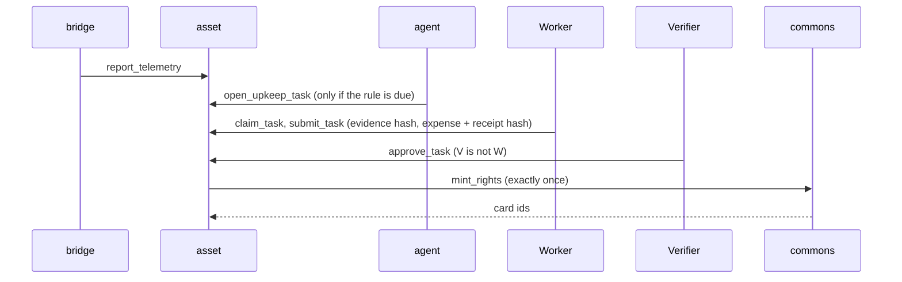

# COMMONKIT

**Shared things that pay for their own upkeep — and open up to the people who keep them alive.**

Fix it, refill it, clean it, check it, teach it — every kind of care that keeps a shared thing alive earns access to it.

> Today a shared machine's money and rules live in one admin's spreadsheet. On COMMONKIT they live in the machine's own keyless NEAR account: no one can drain it, and no one can take back what you earned.
>
> *Precisely:* no method deletes, downgrades or transfers a usage-right card once granted. The DAO can still make a card unusable in practice — by deactivating the asset, moving it to another group, or adding a credential requirement — and that limit is listed under "Security model and honest limits".

Built at NEAR HACKATHON 2026 · Track: **Social Money** · Testnet only.

> **Status (2026-11-10):** work in progress. Every line below is either linked to a test, a testnet tx or a file, or marked *pending*. Nothing marked pending is claimed. Structure: `docs/SUBMISSION.md` §1.

## Try it in 2 minutes

*Pending: the hosted app is not deployed yet (D-025); `<domain>` is a placeholder.*

- Do **open `https://<domain>/app`** (no wallet) → see the board: four testnet assets, each with the SIMULATED badge, their floats vs caps and open upkeep tasks.
- Do **open `https://<domain>/app/proof`** → see account keys, the shared `code_hash`, ledger invariants and DAO proposals, each with an explorer link.
- Do **run `pnpm test:contracts`** in a clean clone → see 402 unit tests and 34 sandbox tests pass, including all 20 `inv_*` invariant tests against the real Sputnik DAO v2 WASM ([`contracts/tests/tests/invariants.rs`](contracts/tests/tests/invariants.rs)).

## What we built during the hackathon

- **Two Rust contracts** — `asset` (one per shared thing, same WASM) and `commons` (roles, credentials, non-transferable NEP-171 cards) — specified in [`docs/CONTRACT_SPEC.md`](docs/CONTRACT_SPEC.md). `pnpm test:contracts` passes: 402 unit + 34 near-workspaces sandbox tests, including the 20 invariant tests listed under "Verify it yourself" (lead rerun 2026-11-10, [`docs/STATUS.md`](docs/STATUS.md)).
- **Two unmodified Sputnik DAO v2 DAOs** created through the testnet factory: `makerlab-ck.sputnikv2.testnet` ([`FjQhBmLT…`](https://testnet.nearblocks.io/txns/FjQhBmLT7oJa7nbNjuoxtQ6rff1jmV7RfVahBUvPmBhb)) and `dorm-b-ck.sputnikv2.testnet` ([`7FEEhTWm…`](https://testnet.nearblocks.io/txns/7FEEhTWmfQrhpicfGCz4TiPEKwNNeXDUWegUXxb9HK2D)).
- **Two commons and four asset accounts** on testnet ([`deployments/testnet.json`](deployments/testnet.json)): commons [`GSpazbSo…`](https://testnet.nearblocks.io/txns/GSpazbSoUiN5UtbStM5cbRc89VdjjXpvH4P2xDk2vuk8) / [`8BqTEpT2…`](https://testnet.nearblocks.io/txns/8BqTEpT2NmisQwGUXmmCAF2UCboiiADGqUmKG8Qw7ggw); `printer-01` [`315qJKEZ…`](https://testnet.nearblocks.io/txns/315qJKEZC1TcrG8q9BAMcdDEew3ZfWXNzcxXDkPmEJwU), `laser-01` [`CjEyTuGY…`](https://testnet.nearblocks.io/txns/CjEyTuGYMUgZBR6wWzZVHFhtejKvAk3c8c4esjy6uKYF), `washer-01` [`8bDy3oxZ…`](https://testnet.nearblocks.io/txns/8bDy3oxZhrTvac1dW3PNB8GJGShkfaJpLCeri4xWbiBS), `fridge-01` [`Djix1a22…`](https://testnet.nearblocks.io/txns/Djix1a22wMz1ZD3xJs6W3L1yyDFi9Uu6T79AB8MvULPm). All four assets run one WASM, `code_hash` `3RpdWfB6MRHyL5wb5ZVFGoKWFLo3uXyDpp592Xdp9g2h` (non-reproducible build, D-216).
- **Governance through DAO proposals** (council votes, [`evidence/seed.json`](evidence/seed.json)): roles [`EAvUeX8k…`](https://testnet.nearblocks.io/txns/EAvUeX8kdkQ2PnU8kqkqJpNe7DvbXGxTwpB761ybgmTq), credential kind `laser_safety` [`4xHWTEPx…`](https://testnet.nearblocks.io/txns/4xHWTEPxggZdvwXVGGg46BTFbMTVec6eLE8R24ZjwFR5), `register_asset laser-01` [`2xvRfaeL…`](https://testnet.nearblocks.io/txns/2xvRfaeL2TAKaygXtNzyWwF4i8VzJmpyenjFfMVu7C3o), `fund_float laser-01` [`C4SxMQqj…`](https://testnet.nearblocks.io/txns/C4SxMQqjFjWAmmkJUi1P7dHMH8SyefeHB2UGPq1V4vSs). The `fund_float washer-01` proposal ([`FDT5HTqL…`](https://testnet.nearblocks.io/txns/FDT5HTqLsYLjjk8vY33KqjQUqohwZa8TGpjqXKn4mfDN)) emitted `float_funded`, `op_created` and `swept`: the float above the cap went back to the DAO.
- **Bridge, agent, web app, device emulators** — in progress ([`bridge/`](bridge), [`agent/`](agent), [`web/`](web); specs in [`docs/`](docs)). No claim beyond their specs until the judge-flow evidence exists.

All tx links: [`evidence/EVIDENCE.md`](evidence/EVIDENCE.md).

## The loop



Full diagrams: [`docs/ARCHITECTURE.md`](docs/ARCHITECTURE.md) §4.

## Scenarios

12 asset profiles, one contract (`docs/PROFILES.md`, `profiles/*.json`). Grouped by upkeep kind; a profile appears under every kind it uses. The Status column matches `meta.status` in each file: the four testnet assets are `simulation`, the other eight `profile example only`. Judges never need hardware (D-022): the testnet assets run through the bridge adapters against device emulators or the simulator, and every event and screen says SIMULATED.

| Upkeep kind | Profile: rule (trigger) | Adapter | Status |
| :--- | :--- | :--- | :--- |
| Maintenance | printer-01 (printer_3d): `nozzle_clean` (Metric), `bed_level` (Metric) | moonraker → emulated Moonraker | simulation (testnet asset) |
| Maintenance | laser-01 (laser_cutter): `lens_clean` (Metric) | smart_plug → emulated Shelly | simulation (testnet asset) |
| Maintenance | washer-01 (washer): `descale` (Metric) | simulator | simulation (testnet asset) |
| Maintenance | gpu_server: `driver_update` (Schedule) · tractor: `oil_change` (Metric) | api_gateway · smart_plug | profile example only |
| Restock | printer-01: `filament_spool` (Metric, receipt ≤ 0.5 NEAR) | moonraker → emulated Moonraker | simulation (testnet asset) |
| Restock | washer-01: `detergent` (Metric, receipt ≤ 0.3 NEAR) | simulator | simulation (testnet asset) |
| Restock | emergency_generator: `fuel_refill` (Metric, receipt ≤ 1 NEAR) | smart_plug | profile example only |
| Cleaning | washer-01: `filter_clean` (Metric) | simulator | simulation (testnet asset) |
| Cleaning | fridge-01 (community_fridge): `weekly_clean` (Schedule) | simulator (D-018) | simulation (testnet asset) |
| Cleaning | gpu_server: `dust_clean` · tractor: `pump_filter_clean` (Schedule) · microscope: `clean_inventory` · rehearsal_room: `room_clean` | api_gateway · smart_plug · manual_qr · smart_lock | profile example only |
| Inspection | laser-01: `monthly_safety_check` (Schedule) | smart_plug → emulated Shelly | simulation (testnet asset) |
| Inspection | fridge-01: `temperature_check` (Metric) | simulator (D-018) | simulation (testnet asset) |
| Inspection | ev_charger: `cable_check` · cargo_bike: `brake_check`, `tire_check` · emergency_generator: `monthly_test_run` (Schedule) · tool_library_ladder: `safety_inspection` | ocpp · smart_lock · smart_plug · manual_qr | profile example only |
| Repair | printer-01: `fault_repair` (Report) | moonraker → emulated Moonraker | simulation (testnet asset) |
| Repair | washer-01: `fault_repair` (Report) | simulator | simulation (testnet asset) |
| Repair | rehearsal_room: `fault_repair` (Report, 2 reports) | smart_lock | profile example only |
| Rebalance | cargo_bike: `return_home` (Report, 2 reports) | smart_lock | profile example only |
| Supervision | rehearsal_room: `evening_supervision` (Schedule) | smart_lock | profile example only |
| Teaching (credential flow, not a rule) | laser-01 `laser_safety` | smart_plug → emulated Shelly | simulation (testnet asset) |

<!-- Adapter column for the testnet assets: confirm against the bridge config before publishing. Add "(simulator scenario)" to a profile-example row only when its scenario file exists and simulate.sh runs it. -->

## Simulation and emulators

Everything a judge runs is simulated and labelled so (D-022). The printer and laser are driven by the bridge's `moonraker` and `smart_plug` adapters against local device emulators that implement the documented API subset (*in progress*, [`docs/BRIDGE_AND_ADAPTERS.md`](docs/BRIDGE_AND_ADAPTERS.md) §4.7); the washer and fridge use the simulator, whose reports carry a `simulated = 1` metric on chain (D-401). Demo thresholds are lowered (`meta.pilot_overrides`, e.g. printer `nozzle_clean` 1 800 s instead of 720 000 s) by DAO `set_profile` proposals; their tx links go here when they run.

## Pilot

**Pilot pending (D-024).** A real-users pilot (≥ 5 people with their own testnet accounts, ≥ 10 reservations, ≥ 1 upkeep task approved by another member, ≥ 1 steward-confirmed return) on a real shared item with the `manual_qr` adapter is planned once the item, people and place are confirmed; one real smart plug with a desk-lamp stand-in (labelled a stand-in) is planned for the video. Plan and runbook: [`docs/PILOT.md`](docs/PILOT.md), [`pilot/RUNBOOK.md`](pilot/RUNBOOK.md). No pilot numbers exist yet. If the pilot does not happen, this section will say so; if it does, it will give the real numbers with tx links, whatever they are.

## Judge flow

*Evidence pending: no judge-flow step has run yet ([`evidence/EVIDENCE.md`](evidence/EVIDENCE.md)). Each step is `pnpm demo:step N`; device steps run against emulators or the simulator.*

The five core steps first:

| # | Do | See | Step |
| :--- | :--- | :--- | :--- |
| 1 | Reserve a printer slot, then ask the bridge for access with a signed request | Reservation Confirmed; bridge 200; `session_started`; the emulated printer starts the job (SIMULATED) | 2–3 |
| 2 | Ask for access with no reservation | Bridge 403, no on-chain change | 4 |
| 3 | Let telemetry make a rule due; agent opens the upkeep task; a member does it; a different member approves | `task_opened` with rationale; task Rewarded; 2 non-transferable cards minted | 7–8 |
| 4 | Push fees over the float cap | `swept` event; DAO treasury grows by the excess | 6 |
| 5 | Run `./scripts/verify.sh` | Account keys, one `code_hash`, ledger invariants, rights ↔ tasks, reimbursement caps, out-of-service periods | 21 |

All 21 steps, with the negative cases (no credential, wrong group, agent limits, double reward, self-approval, revocation attempt, over-cap expense, fault report without a session, Schedule rule not yet due): [`docs/DEMO_SCRIPT.md`](docs/DEMO_SCRIPT.md) §2.

<!-- When evidence exists: one row per step 1–21 with Do → See → `pnpm demo:step N` → evidence link. -->

## Verify it yourself

```bash
pnpm install --frozen-lockfile
pnpm test:contracts          # 402 unit + 34 sandbox tests (lead rerun 2026-11-10)
./scripts/verify.sh          # read-only checks against testnet (keyless check still pending, see limits)
```

Invariant tests ([`contracts/tests/tests/invariants.rs`](contracts/tests/tests/invariants.rs), all passing): `inv_custody_float_cap_sweeps_excess`, `inv_custody_deposits_never_swept`, `inv_no_retroactive_revocation`, `inv_no_self_verification_task`, `inv_no_self_verification_training`, `inv_exactly_once_reward_retry`, `inv_failed_refund_keeps_claim`, `inv_no_double_booking_concurrent`, `inv_slots_released_on_rejection`, `inv_agent_bounded_rule_not_due`, `inv_agent_bounded_quota`, `inv_agent_revoked`, `inv_ledger_balance_covers_obligations`, `inv_rights_group_scope`, `inv_non_transferable`, `inv_credential_required`, `inv_restock_expense_capped_and_not_from_deposits`, `inv_out_of_service_blocks_access_and_refunds`, `inv_fault_report_requires_recent_session`, `inv_schedule_rule_due_only_after_interval`.

`./scripts/simulate.sh <asset_type>` for all 12 profiles is pending.

## Social Money compliance

| Requirement | How COMMONKIT meets it | Verified by |
| :--- | :--- | :--- |
| Shared budgets | DAO treasury + a capped operating float per asset | `inv_custody_float_cap_sweeps_excess`; washer-01 sweep [`FDT5HTqL…`](https://testnet.nearblocks.io/txns/FDT5HTqLsYLjjk8vY33KqjQUqohwZa8TGpjqXKn4mfDN) |
| Programmable rewards | Upkeep tasks opened from on-chain rule status, rewarded once after independent approval | `inv_exactly_once_reward_retry`, `inv_agent_bounded_rule_not_due`, `inv_agent_bounded_quota`; judge steps 7–8 (pending) |
| Shared ownership | Asset accounts governed by the DAO, without keys | keyless: *pending* (deploy keys not deleted yet) |
| Reputation-based access | Credential cards; lower deposit after clean returns | `inv_credential_required`; judge steps 11–13 (pending) |
| Existing DAO for custody and approval | Community money and large payments stay in Sputnik; float above the cap goes back | `inv_custody_deposits_never_swept`; DAO proposals in [`evidence/seed.json`](evidence/seed.json) |
| No new multisig | Unmodified Sputnik DAO v2 from the testnet factory | DAO creation [`FjQhBmLT…`](https://testnet.nearblocks.io/txns/FjQhBmLT7oJa7nbNjuoxtQ6rff1jmV7RfVahBUvPmBhb), [`7FEEhTWm…`](https://testnet.nearblocks.io/txns/7FEEhTWmfQrhpicfGCz4TiPEKwNNeXDUWegUXxb9HK2D) |
| Named accounts | Every asset, commons and member is a named account | [`deployments/testnet.json`](deployments/testnet.json) |
| Every reputation point traceable | Each record carries a task/session id and a NEP-297 event | judge steps (pending) |
| Tiered approval | Auto / council / DAO proposal by amount | `inv_restock_expense_capped_and_not_from_deposits`; [`docs/CONTRACT_SPEC.md`](docs/CONTRACT_SPEC.md) §3.3 |
| Public board | Wallet-free board of tasks, workers, rights and payments | hosted app (pending) |

## Architecture

| Account | What |
| :--- | :--- |
| `makerlab-ck.sputnikv2.testnet`, `dorm-b-ck.sputnikv2.testnet` | Sputnik DAO v2 (treasury, council) |
| `commons.makerlab…`, `commons.dorm-b…` | `commons` contract: roles, credentials, usage-right cards |
| `printer-01`, `laser-01` (makerlab), `washer-01`, `fridge-01` (dorm-b) | `asset` contract, one WASM |
| `bridge.commonkit-sxflo.testnet`, `agent.commonkit-sxflo.testnet` | Operators with one function-call key per asset |

Full account list: [`deployments/testnet.json`](deployments/testnet.json). Specs: [`docs/ARCHITECTURE.md`](docs/ARCHITECTURE.md), [`docs/CONTRACT_SPEC.md`](docs/CONTRACT_SPEC.md), [`docs/BRIDGE_AND_ADAPTERS.md`](docs/BRIDGE_AND_ADAPTERS.md), [`docs/AGENT_SPEC.md`](docs/AGENT_SPEC.md), [`docs/DAO_INTEGRATION.md`](docs/DAO_INTEGRATION.md).

## Security model and honest limits

- **Testnet only.** Testnet NEAR has no value.
- **Keyless is pending.** The six contract accounts still hold their deploy key; deletion and the `verify.sh` check come next ([`deployments/testnet.json`](deployments/testnet.json) marks them `pending`).
- **No reproducible build.** The deployed `code_hash` comes from a local non-reproducible build (D-216).
- **No physical device tested yet.** The adapters are tested against device emulators that implement the documented API subset (D-022). The planned real plug powers a desk-lamp stand-in, not a machine (D-024).
- **The bridge is trusted.** Telemetry alone never pays anyone; an independent member approves every task; the DAO can remove the bridge operator.
- **Physical bypass is possible** in a real installation (unplugging, the device's own buttons). It needs social control.
- **Smart-plug telemetry is indirect.** Cycles and run time are inferred from power; miscounts are possible.
- **Upkeep and training quality** need human judgement; verification tests are supporting evidence.
- **A credential card is not a legal certificate**; it is a community rule.
- **One account is not one person.** Roles are managed by the DAO.
- **No retroactive revocation, precisely:** no method deletes, downgrades or transfers a granted card; the DAO can still make a card unusable in practice (deactivating the asset, moving it to another group, adding a credential requirement).
- **Privacy:** photos never go on chain, only their sha256.
- **No Trezu integration** (below). **No security audit.** **Business model not validated.**

## Trezu

COMMONKIT uses the same Sputnik DAO contract that Trezu builds on, without modification. Proposals opened by asset contracts are standard Sputnik proposals, so Sputnik-based treasury interfaces such as Trezu should list them. Because the hosted Trezu app could not be used on testnet during the hackathon, we do not claim an end-to-end Trezu integration.

## Run locally

```bash
pnpm install
pnpm build:contracts
pnpm test:contracts
pnpm test
```

## Built with

<!-- libraries, templates, AI tools (Claude Code), per HACKATHON.md Q-005. Pilot QR sheets: qrcode (MIT), pdf-lib + @pdf-lib/fontkit (MIT), DejaVu Sans fonts (Bitstream Vera-derived license). -->

## Hackathon window

All code in this repository was written after the hackathon announcement (2026-10-19). First commit: <!-- link -->

## License

MIT
