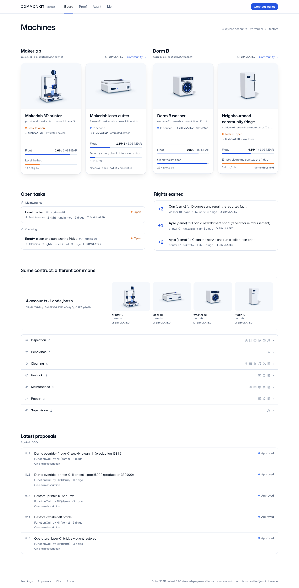
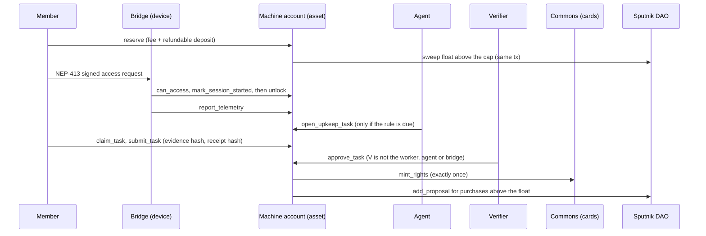
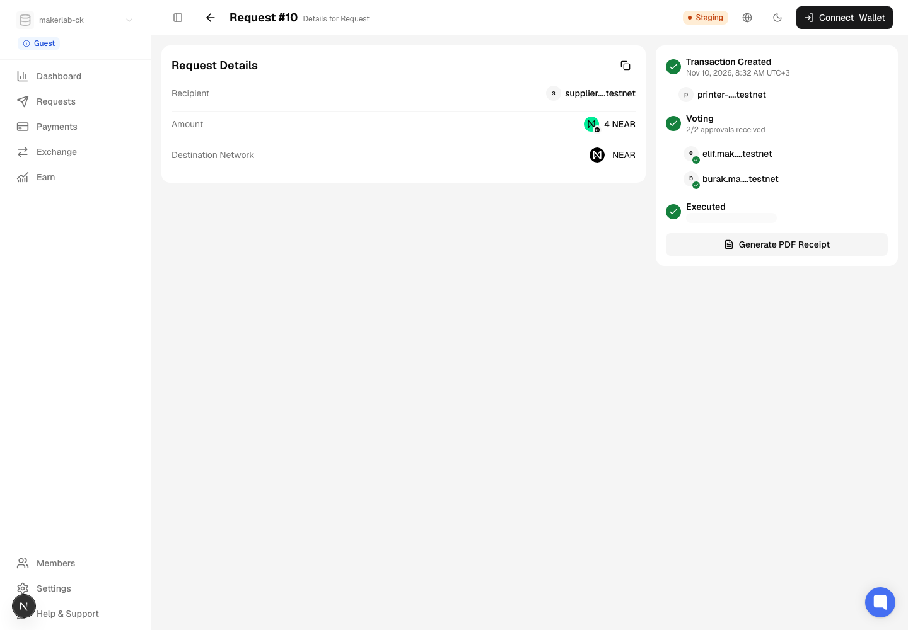
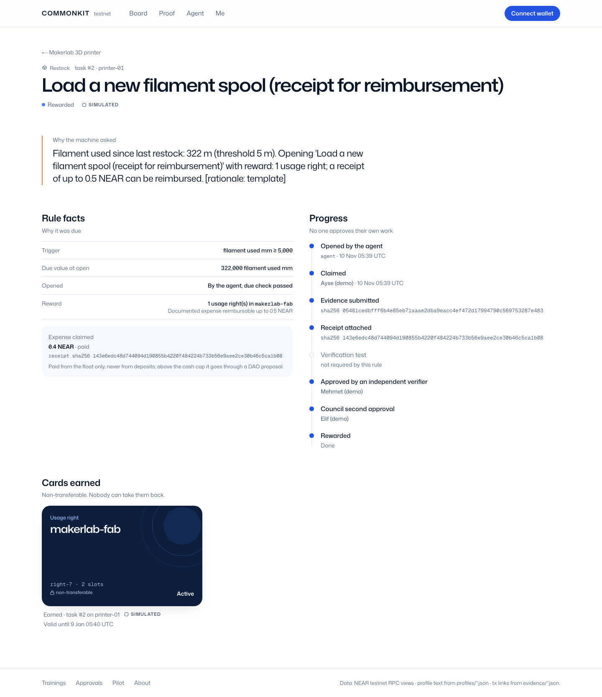
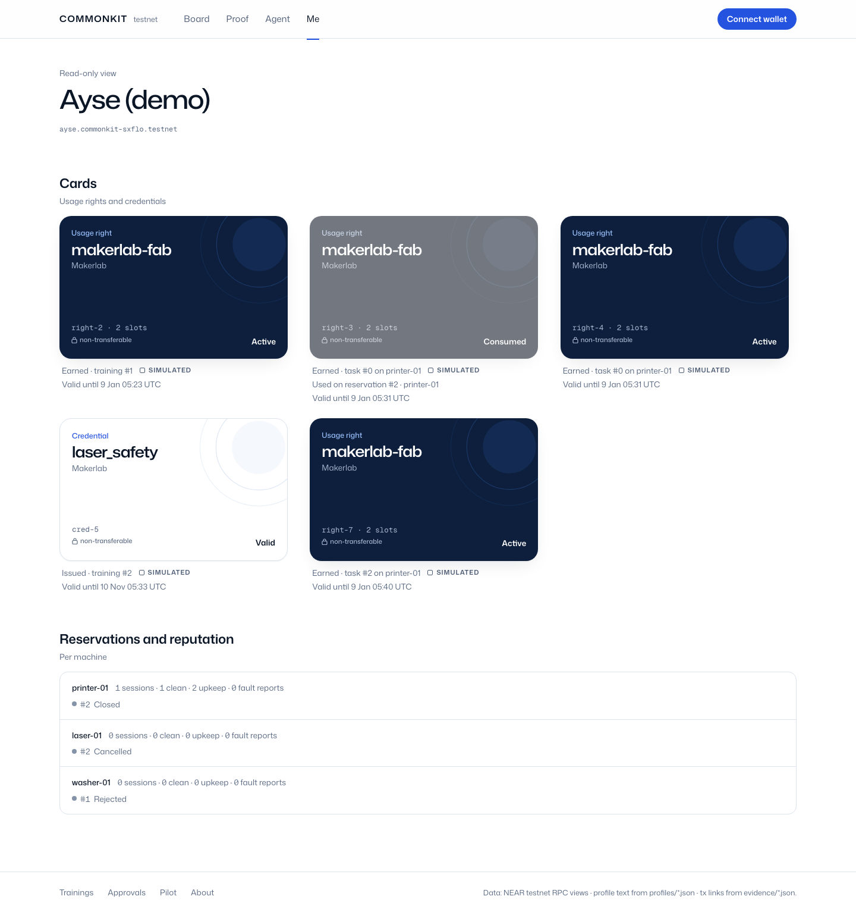

# COMMONKIT

**Shared things that pay for their own upkeep, and open up to the people who keep them alive.**

A makerspace printer, a dorm washer, a co-op tractor, a street fridge: everyone uses them, few look after them, and their money and rules sit in one admin's spreadsheet. COMMONKIT gives each shared thing its own keyless NEAR account. Members book it on chain and a bridge next to the device unlocks it only for a valid booking. Fees fill a small capped float; everything above the cap goes to the community's Sputnik DAO. When the machine needs care, it opens an upkeep task; a member does the work, a different member approves it, and the worker earns usage-right cards that nobody can take back.

> Today a shared machine's money and rules live in one admin's spreadsheet. On COMMONKIT they live in the machine's own keyless account: no one can drain it, and no one can take back what you earned. ([exact scope](#security-model-and-limits))

Built at NEAR HACKATHON 2026 for **Social Money** (`social`) and **NFTs That Do Something** (`nfts`). Live on NEAR testnet: two unmodified Sputnik DAOs, two community contracts and four machine accounts, all keyless, with 21 judge steps recorded as transactions. Devices run against API-faithful emulators (Moonraker, Shelly) and a simulator, so anyone can run the full loop without hardware; every device reading is labelled SIMULATED where it is shown.

**App:** https://commonkit.cayvox.com/app/ · **Video (90 s):** <VIDEO_URL> · **Verify:** `./scripts/verify.sh` (read-only, no keys) · **21 steps with tx links:** [`docs/JUDGE_FLOW.md`](docs/JUDGE_FLOW.md) · **Evidence:** [`evidence/EVIDENCE.md`](evidence/EVIDENCE.md)



*The board reads NEAR testnet views directly; no wallet needed. Screenshot: [`web/screenshots/board-1440.png`](web/screenshots/board-1440.png).*

## Try it

No keys and no wallet needed. The hosted site is https://commonkit.cayvox.com (landing at `/`, app at `/app/`). If it does not resolve yet, serve the same build locally: `pnpm install --frozen-lockfile && pnpm build:site && pnpm serve:site`, then use `http://localhost:4320` in place of the host below (Node ≥ 22, pnpm).

| Do | See |
| :--- | :--- |
| Open https://commonkit.cayvox.com/app/ | Four machines (printer, laser, washer, fridge) in two communities, each with its float against its cap, open upkeep tasks, rights earned and the latest Sputnik proposals. |
| Open `/app/a/printer-01.makerlab.commonkit-sxflo.testnet` | The printer's account: fee and deposit per slot, its upkeep rules and how close each is to due, its money (float, deposits held, total swept to the DAO). |
| Open `/app/t/printer-01.makerlab.commonkit-sxflo.testnet/0` | The nozzle-cleaning task: why the machine asked (telemetry vs threshold), who claimed it, the independent approval, and the two cards it minted. |
| Open `/app/me?as=ayse.commonkit-sxflo.testnet` | Ava's cards (usage rights, one already used on a booking, and a `laser_safety` credential) and her record per machine. Any account id works. |
| Open `/app/proof` | Access keys per contract account (0), the shared `code_hash`, the ledger invariants and explorer links. |
| Run `./scripts/verify.sh` | 91 lines, no ❌, exit 0, in about 84 s: no keys on the eight contract and DAO accounts, one asset `code_hash`, operator key scopes, ledgers, sweeps, rights ↔ tasks, escalations, reimbursement caps, service log and all 21 judge steps re-read from chain ([`evidence/verify-step21.txt`](evidence/verify-step21.txt)). |
| Run `./scripts/simulate.sh washer --fake` | In about a second, the loop on in-memory fake chains: NEP-413 signed access → bridge 200, simulated telemetry makes `filter_clean` due, the agent opens the cleaning task, the bridge verification passes. Lines it cannot model say "skipped"; drop `--fake` for the real contracts on a local sandbox ([Run locally](#run-locally)). |
| Watch the video: <VIDEO_URL> | One walkthrough of the site reading testnet live: board → printer → booking → upkeep task with independent approval and cards → refused card transfer → float swept to the DAO → proof. Synthetic narration voice. |

## Why it has to be on NEAR

- **Each machine is a named account with no keys.** `printer-01.makerlab.commonkit-sxflo.testnet` is a sub-account of its community. Its full-access key was deleted after deployment ([`Bf6gbxyT…`](https://testnet.nearblocks.io/txns/Bf6gbxyTuguCeP4qm6ZDj4Mekmuhhbyi4nRzTb517EK3)), so its money moves only by its code. `verify.sh` check [1] shows 0 access keys on all eight contract and DAO accounts.
- **One code for every machine.** All four machine accounts share `code_hash` `3RpdWfB6MRHyL5wb5ZVFGoKWFLo3uXyDpp592Xdp9g2h` (check [2]); a new kind of commons is a new profile, not a new contract.
- **Function-call keys bound the helpers.** The bridge's key on each machine can call only `mark_session_started`, `mark_session_finished`, `report_telemetry` and `submit_verification_result`; the agent's only `open_upkeep_task`, `annotate_task`, `escalate`, `sync_escalation` and `refresh_dao_policy` (check [5]). A function-call key cannot attach a deposit or call any other method ([access keys](https://docs.near.org/protocol/accounts-contracts/access-keys)), and the DAO can replace either operator with `set_operators`; step 16 shows the removed agent refused ([`4LTTFcJq…`](https://testnet.nearblocks.io/txns/4LTTFcJq3aJZM2UwMDaqBymkdMUZ9RH7SaAkyBF9Yomc) `E_NOT_AGENT`).
- **The treasury is an unmodified Sputnik DAO.** Both DAOs come from the testnet factory and run its default code (check [4]). The machine's own contract opens Sputnik proposals with its own bond when it needs more than its float (step 10, [`4vcji9GS…`](https://testnet.nearblocks.io/txns/4vcji9GSXnsZcSwhN74r1raEnRZXVnEVUpPFHeCYh3Df)).
- **Earned access is a token.** Usage rights and credentials are NEP-171 cards (NEP-177 metadata, NEP-181 enumeration) that change state as they are used and cannot be transferred or revoked ([Cards that do something](#cards-that-do-something)).
- **The device checks a signature, not a password.** A member signs a NEP-413 message; the bridge verifies it against the member's full-access key, calls `can_access`, and writes the session on chain before it unlocks (step 3). A refusal costs nothing: no transaction is sent (step 4).

## The loop



Full diagrams: [`docs/ARCHITECTURE.md`](docs/ARCHITECTURE.md) §4.

## What is proven on testnet

The five core steps of the 21-step judge flow ([`docs/JUDGE_FLOW.md`](docs/JUDGE_FLOW.md), every tx in [`evidence/EVIDENCE.md`](evidence/EVIDENCE.md)). Alex, Casey, Ava and Mark are display names for team-controlled demo accounts (`ali.`, `can.`, `ayse.`, `mehmet.commonkit-sxflo.testnet`).

| Do | See | Tx |
| :--- | :--- | :--- |
| Alex books 2 printer slots and asks the bridge for access with a signed request | Fee 0.5 NEAR to the float, deposit 2 NEAR held as a liability; the session is written on chain before the emulated printer starts (SIMULATED) | [`3hHS1wra…`](https://testnet.nearblocks.io/txns/3hHS1wra65mLrgztB94qVNeLiUsLzNRvkfK3CbBzp6Qz), [`ARRc2y3M…`](https://testnet.nearblocks.io/txns/ARRc2y3M1WwSKcCfcCkp7PpmMDBGBrqWoJ3zkTNMmKwz) |
| Casey, with no booking, asks for access | `can_access` → `not_holder`, bridge 403, printer stays idle | none by design: refused before any write |
| Print time crosses `nozzle_clean`; Ava claims, the bridge runs a calibration print, Mark approves | The agent opens the task; Ava receives `right-3` and `right-4` | [`AbQSVeSa…`](https://testnet.nearblocks.io/txns/AbQSVeSayT76JeE4jikELhUUs3QEEmaqMjrmYHQrAvem), [`5RAh6R1w…`](https://testnet.nearblocks.io/txns/5RAh6R1wsw7SKYN4sv6XMLmQdRjZ67KAmNgsoEQWD6rr), [`Gr7bwqmC…`](https://testnet.nearblocks.io/txns/Gr7bwqmCWqTzxqa4fSrmNHdZyexyar2eAoSidRfrPhQx) |
| Alex books more printer time and the float passes its 3 NEAR cap | `swept` 0.0499 NEAR in the same tx; DAO treasury 5.6511 → 5.701 NEAR | [`DBTLyXkr…`](https://testnet.nearblocks.io/txns/DBTLyXkrBuovZTd6xyc9Ys3WnfBuHfiLgfEqJJquC31S) |
| Run `./scripts/verify.sh` | Every claim above re-read from chain, exit 0 | [`evidence/verify-step21.txt`](evidence/verify-step21.txt) |

The other 16 steps cover the credential gate, training, earned rights spent on bookings, the machine-opened DAO proposal, capped reimbursements, a fault taking a machine out of service, a scheduled cleaning, and every refusal the contracts promise (agent out of bounds, self-approval, double reward, card transfer).

## Real-world commons

One contract, twelve profiles ([`profiles/*.json`](profiles)). Care is broader than repair: members refill, clean, inspect, train, bring things back and host. Each line gives what a member does and what it earns or what the money does; every number comes from the profile file. Each right books a machine in its group without a fee and expires 60 days after it is minted.

| Need | Shared thing | A member… | …and the result | Status |
| :--- | :--- | :--- | :--- | :--- |
| Keep it running | Makerlab 3D printer | cleans the nozzle every 200 print hours; repairs a reported fault | 2 rights; 3 rights plus a receipt-backed expense up to 0.5 NEAR. Fees (0.25 NEAR per slot) fill a 3 NEAR float, the rest goes to the DAO treasury | simulation (testnet asset) |
| | Co-op tractor | changes the oil every 100 engine hours | 4 rights; booking needs a `tractor_operator` credential; 10 NEAR float cap | profile example only (simulator scenario) |
| | Lab GPU server | updates drivers every 30 days and passes the test suite | 2 rights; booking needs `gpu_basics` | profile example only (simulator scenario) |
| Keep it stocked and clean | Dorm B washer | cleans the lint filter every 30 cycles; refills detergent every 40; descales every 120 | 3 rights; 1 right plus up to 0.3 NEAR for the receipt; 5 rights. 0.2 NEAR per 60-minute slot, 1 NEAR float cap | simulation (testnet asset) |
| | Neighbourhood fridge | empties and cleans it weekly; checks the seal after 6 high-temperature readings | 2 rights; 1 right. Free to use, 0.1 NEAR refundable deposit | simulation (testnet asset) |
| | School microscope | cleans the optics and checks the inventory every 20 loans | 1 right; free loan against a 1 NEAR deposit | profile example only (simulator scenario) |
| Keep it safe and trained | Makerlab laser cutter | trains another member; runs the monthly safety check; cleans the lens every 40 h | Trainee gets a `laser_safety` credential, the trainer a usage right; 1 right; 2 rights. No credential, no booking | simulation (testnet asset) |
| | Emergency generator | test-runs it monthly; refuels it after 20 L | 2 rights; 1 right plus up to 1 NEAR for the fuel receipt; operators need `generator_operator` | profile example only (simulator scenario) |
| | Site EV charger | inspects cable and connector every 100 sessions | 2 rights; 0.5 NEAR per slot into a 5 NEAR float | profile example only (simulator scenario) |
| | Tool library ladder | inspects rungs, feet and locks every 25 loans | 1 right; the 1 NEAR deposit drops to 0.5 after 3 clean returns | profile example only (simulator scenario) |
| Keep it fair and shared | Street cargo bike | brings it back to its home spot when 2 members report it away; checks brakes every 300 km | 1 right; 2 rights; the 3 NEAR deposit drops to 1 after 5 clean returns | profile example only (simulator scenario) |
| | Rehearsal room | hosts the weekly open-room evening; repairs a fault 2 members reported | 2 rights; 3 rights plus up to 0.5 NEAR | profile example only (simulator scenario) |

All twelve run the full loop on a local NEAR sandbox with the real contracts: `./scripts/simulate.sh all` → 12/12 PASS ([`evidence/simulate-all-2026-11-10.txt`](evidence/simulate-all-2026-11-10.txt)). The rule-by-rule matrix by upkeep kind (maintenance, restock, cleaning, inspection, repair, rebalance, supervision) is in [`docs/SCENARIOS.md`](docs/SCENARIOS.md).

## How a community runs it

COMMONKIT does not replace the multisig. The community keeps its Sputnik DAO; COMMONKIT is what the community does with it for the things it shares.

**Money stays where the community already governs it.** A machine holds members' deposits (a liability, never revenue), rewards it has promised, a storage reserve and a free float up to its cap. Anything above the cap is swept to the DAO in the same transaction (step 6, `inv_custody_float_cap_sweeps_excess`; deposits are never swept: `inv_custody_deposits_never_swept`). When the machine needs something its float cannot pay, its own contract opens a Sputnik `Transfer` proposal; the council votes and the DAO pays the supplier 4 NEAR (step 10: proposal [`4vcji9GS…`](https://testnet.nearblocks.io/txns/4vcji9GSXnsZcSwhN74r1raEnRZXVnEVUpPFHeCYh3Df), votes [`AdosFdrv…`](https://testnet.nearblocks.io/txns/AdosFdrvh23pf5ZWTY6AaoETN38BBpgMYtfyUfS3TSjg), [`G3NUkpTv…`](https://testnet.nearblocks.io/txns/G3NUkpTvpBjuUBQDSvYG1dJm2TQ7VVTXqTup892p9SeY)). The reason: a machine should run itself day to day, and nothing larger than its float should leave the treasury without a vote.

**Approvals scale with the amount.** Rewards are mostly usage rights. When work also carries cash or an expense, the approval path follows the amount (profile values, 0.25 and 0.5 NEAR in all four testnet profiles):
- up to `council_threshold_cash`: one independent verifier;
- above it: the verifier plus a council member. In step 18 Ava's 0.4 NEAR filament receipt was approved by Mark, then by council member Ellie ([`42VT5eby…`](https://testnet.nearblocks.io/txns/42VT5ebyCVy5953yu3RDDCuUMTz2YwYEMYQVTq7zEodG)); her first claim of 0.6 NEAR was refused against the rule's 0.5 NEAR cap ([`Ej4HpM7X…`](https://testnet.nearblocks.io/txns/Ej4HpM7XQG7RaKRCRYf25yPSnUdte52VpHNaYBGQ1JH6) `E_EXPENSE_CAP`);
- above `auto_reward_cash_cap`: only through a DAO proposal the machine opens.

Nothing approves itself, even for trusted members: the worker, the agent and the bridge can never approve a task, and a trainer cannot approve their own training (`inv_no_self_verification_task`, `inv_no_self_verification_training`; step 17 [`8TVggJbH…`](https://testnet.nearblocks.io/txns/8TVggJbHvMecXucRykG7oEPRnt5AmmCQy4XVVo4zPKMj) `E_SELF_VERIFY`). That is the line against self-dealing; the cost is one second pair of eyes per task.

**Reputation comes from finished work, per named account.** Every record names the account and carries the task or session id in a `reputation_recorded` event: sessions, clean returns, upkeeps, fault reports. Every card records the task or training that earned it, and `verify.sh` check [7] matches each card to its rewarded task. A good record lowers the member's deposit (printer: 2 NEAR → 0.5 NEAR after 3 clean returns; `reserve_uses_trusted_deposit_after_clean_returns` in [`contracts/asset/src/tests/reservations.rs`](contracts/asset/src/tests/reservations.rs)) and earns access. It does not raise how much cash a member can be paid without the council: cash limits are fixed per profile and only a DAO `set_profile` proposal changes them.

**Every change to the rules is a proposal.** Registering a machine, setting its profile, funding its float and replacing its operators are Sputnik `FunctionCall` proposals. Five of them are also Trezu custom proposal templates, compiled with Trezu's own engine into the exact proposal our scripts send (`pnpm trezu:test`, [`scripts/trezu/templates.test.ts`](scripts/trezu/templates.test.ts)). One filed a real proposal that the council passed: `dorm-b-ck.sputnikv2.testnet#13`, fund washer-01's float with 0.05 NEAR ([`D521qH6m…`](https://testnet.nearblocks.io/txns/D521qH6mg4qm3Tt1Ck57Mo9JVsY6pgzqXZxjAWpPVF6n), executing vote [`EHzqNtod…`](https://testnet.nearblocks.io/txns/EHzqNtodFNQjiEYFFEMswNX9VCbPjYsje9NjgkeEb8b2)). Trezu's open-source UI, run locally on its official testnet mock backend, shows the proposal the printer opened for itself:



The hosted Trezu app is mainnet-only, so it was not used; #13 was filed by our script with the engine's exact output rather than through Trezu's form ([`integrations/trezu/README.md`](integrations/trezu/README.md), D-037).

**What Sputnik already does, and what COMMONKIT adds.** Sputnik provides roles, votes with thresholds, proposal bonds, `Transfer`, `FunctionCall`, policy changes and native bounties. COMMONKIT adds, without changing Sputnik: machine-opened proposals, a capped float with automatic sweep, a bounded agent, an independent verifier with a council second approval by amount, exactly-once rewards, non-revocable rights and physical access gated by a booking. Upkeep tasks are not Sputnik bounties because they pay in access and are opened from on-chain rule status. Full answer with sources: [`docs/APPROVAL_FLOWS.md`](docs/APPROVAL_FLOWS.md).



*Task #2 on printer-01 (`/app/t/printer-01.makerlab.commonkit-sxflo.testnet/2`): the restock from step 18.*

## Cards that do something

The machine is the account that owns money: its float, members' deposits and the fees it earns. The cards are what a member owns: access to that machine, earned by looking after it.

Two kinds of card live on each community's `commons` contract as NEP-171 tokens with NEP-177 metadata and NEP-181 enumeration:
- **Usage rights**, earned by upkeep or by training someone. A booking that uses one pays no fee (step 9, [`5HGbP8ji…`](https://testnet.nearblocks.io/txns/5HGbP8ji8pyb53vJdCqhWWJzoVGpVDynx1v11HKouyD6)). A right is scoped to an asset group: a printer right works on the laser in the same makerlab group and is refused on the dorm's washer (step 14, `inv_rights_group_scope`).
- **Credentials**, such as `laser_safety`. The laser refuses a booking without one ([`DWyA3hq1…`](https://testnet.nearblocks.io/txns/DWyA3hq1TyJwyafuZGVr3CmfagmpBMokLeYMLyji2Es3) `E_CREDENTIAL_MISSING`); after a training approved by a third member, the trainee holds one and the trainer earns a right ([`6wdSrqts…`](https://testnet.nearblocks.io/txns/6wdSrqtsVq4Ri3pWsGMgyJ8KAPp6CD5JXewDZTPLnBeM); `inv_credential_required`).

**The card's state is its behaviour.** A right moves Active → Locked (booked) → Consumed after the session ([`77GL79HW…`](https://testnet.nearblocks.io/txns/77GL79HW25Rn6bNoJRnvhDFWrGiWBXhw33WL92Thoe7a)), back to Active when its holder cancels ([`U8fudsCe…`](https://testnet.nearblocks.io/txns/U8fudsCesicZ48BQvaCupc9pi5qYTDwJMRhHUVjYvpf)), or expires at a time fixed when it was minted. `nft_token` metadata is computed from that state ([`contracts/commons/src/nft.rs`](contracts/commons/src/nft.rs)), and `get_card` returns what earned the card and the reservation it was spent on.

**Why the cards cannot be sold.** Access earned by caring for a machine should stay with the person who did the work, and a card that cannot move leaves no way for a seller to keep the access or the money. `nft_transfer`, `nft_transfer_call` and `nft_approve` always fail (`inv_non_transferable`; council member Ellie trying to move Ava's card: [`35LAjegU…`](https://testnet.nearblocks.io/txns/35LAjegUjbzPtUoDFhoTm1kxRtfNRJw7sS3GsqhDx6ov) `E_NON_TRANSFERABLE`), and there is no revoke or burn method ([`8baJx53v…`](https://testnet.nearblocks.io/txns/8baJx53vEdMZ7WK5U7M729JTbnFxXxkZw8n9UTT2RKBi), [`7SQ1suu3…`](https://testnet.nearblocks.io/txns/7SQ1suu3BW3NZM8F9VvgW2AHH5wPLJPezoy1Wz7bPRYr): `MethodNotFound`; `inv_no_retroactive_revocation`). The track's example prompt is a transferable membership NFT whose wallet moves with it; COMMONKIT takes the opposite position on purpose. The gate is the machine itself: the bridge unlocks a device only for an on-chain reservation.



Check the standard views yourself with near-cli-rs (0.31.1 used here); on 2026-11-13 `nft_metadata` returned `spec: "nft-1.0.0"` and `nft_total_supply` returned 7:

```bash
near contract call-function as-read-only commons.makerlab.commonkit-sxflo.testnet nft_total_supply json-args '{}' network-config testnet now
near contract call-function as-read-only commons.makerlab.commonkit-sxflo.testnet nft_tokens json-args '{"from_index":"0","limit":7}' network-config testnet now
```

## What was built

- **Two Rust contracts**: `asset` (one per shared thing, same WASM everywhere) and `commons` (roles, credentials, NEP-171 cards), per [`docs/CONTRACT_SPEC.md`](docs/CONTRACT_SPEC.md). `pnpm test:contracts`: 402 unit tests and 36 near-workspaces sandbox tests against the real Sputnik DAO v2 WASM, including 20 invariant tests ([`contracts/tests/tests/invariants.rs`](contracts/tests/tests/invariants.rs); output [`evidence/ci-local/test-contracts-2026-11-10.txt`](evidence/ci-local/test-contracts-2026-11-10.txt)).
- **On testnet**: DAOs `makerlab-ck.sputnikv2.testnet` [`FjQhBmLT…`](https://testnet.nearblocks.io/txns/FjQhBmLT7oJa7nbNjuoxtQ6rff1jmV7RfVahBUvPmBhb) and `dorm-b-ck.sputnikv2.testnet` [`7FEEhTWm…`](https://testnet.nearblocks.io/txns/7FEEhTWmfQrhpicfGCz4TiPEKwNNeXDUWegUXxb9HK2D); commons deploys [`GSpazbSo…`](https://testnet.nearblocks.io/txns/GSpazbSoUiN5UtbStM5cbRc89VdjjXpvH4P2xDk2vuk8), [`8BqTEpT2…`](https://testnet.nearblocks.io/txns/8BqTEpT2NmisQwGUXmmCAF2UCboiiADGqUmKG8Qw7ggw); machines `printer-01` [`315qJKEZ…`](https://testnet.nearblocks.io/txns/315qJKEZC1TcrG8q9BAMcdDEew3ZfWXNzcxXDkPmEJwU), `laser-01` [`CjEyTuGY…`](https://testnet.nearblocks.io/txns/CjEyTuGYMUgZBR6wWzZVHFhtejKvAk3c8c4esjy6uKYF), `washer-01` [`8bDy3oxZ…`](https://testnet.nearblocks.io/txns/8bDy3oxZhrTvac1dW3PNB8GJGShkfaJpLCeri4xWbiBS), `fridge-01` [`Djix1a22…`](https://testnet.nearblocks.io/txns/Djix1a22wMz1ZD3xJs6W3L1yyDFi9Uu6T79AB8MvULPm); full-access keys deleted [`7rxMTZ3k…`](https://testnet.nearblocks.io/txns/7rxMTZ3k9BpHVeVKHTmK9Nr2s6JtWvEK4nJoGQLyog7X) [`3qmAWFX7…`](https://testnet.nearblocks.io/txns/3qmAWFX7C9GoV2Jk2mRZjLYo2dhKoP31g6Jo1qQQmbMg) [`Bf6gbxyT…`](https://testnet.nearblocks.io/txns/Bf6gbxyTuguCeP4qm6ZDj4Mekmuhhbyi4nRzTb517EK3) [`BXJTZ5Rc…`](https://testnet.nearblocks.io/txns/BXJTZ5RczfieprUA1s4GSM5E694Qzc5RNxL3EWgiW2Jd) [`HEfVWQF8…`](https://testnet.nearblocks.io/txns/HEfVWQF8uNvtKoNNHHcn3kdkU1zNqCWxU4nHHxf9pT5D) [`CMExFncD…`](https://testnet.nearblocks.io/txns/CMExFncD6yjKEzZPf4tXPTSFUEWQHuSoEAqXnVC9GKyd). All accounts: [`deployments/testnet.json`](deployments/testnet.json).
- **Bridge** ([`bridge/`](bridge), TypeScript, Fastify): NEP-413 access checks against full-access keys only (D-019), the chain write before the unlock (D-404), `moonraker` and `smart_plug` adapters run against device emulators of the documented APIs (steps 3, 8, 13), and a simulator (steps 15, 19, 20).
- **Operations agent** ([`agent/`](agent), TypeScript): opens upkeep tasks only when `get_rule_status` says due and escalates purchases through the machine's own Sputnik proposals. The contract refused every out-of-bounds attempt on testnet: not due, duplicate, over quota, after removal ([`evidence/agent-limits.json`](evidence/agent-limits.json), step 16). Rationales come from templates; no LLM is used (D-107).
- **Web app** under `/app` and a landing page at `/` ([`web/`](web), [`landing/`](landing)), reading testnet without a wallet; wallet actions through `@hot-labs/near-connect`.
- **`simulate.sh`**: the whole loop for all 12 profiles on a private local NEAR sandbox with the real contracts, the real Sputnik WASM, the bridge and the agent (D-420).

Accounts at a glance:

| Account | Role |
| :--- | :--- |
| `makerlab-ck.sputnikv2.testnet`, `dorm-b-ck.sputnikv2.testnet` | Sputnik DAO v2: treasury and council |
| `commons.makerlab.commonkit-sxflo.testnet`, `commons.dorm-b.commonkit-sxflo.testnet` | `commons`: roles, credentials, cards |
| `printer-01`, `laser-01` (`.makerlab.commonkit-sxflo.testnet`), `washer-01`, `fridge-01` (`.dorm-b.commonkit-sxflo.testnet`) | `asset`, one WASM, keyless |
| `bridge.commonkit-sxflo.testnet`, `agent.commonkit-sxflo.testnet` | Operators, one function-call key per machine |

Specs: [`docs/ARCHITECTURE.md`](docs/ARCHITECTURE.md), [`docs/CONTRACT_SPEC.md`](docs/CONTRACT_SPEC.md), [`docs/BRIDGE_AND_ADAPTERS.md`](docs/BRIDGE_AND_ADAPTERS.md), [`docs/AGENT_SPEC.md`](docs/AGENT_SPEC.md), [`docs/DAO_INTEGRATION.md`](docs/DAO_INTEGRATION.md). Decisions: [`docs/DECISIONS.md`](docs/DECISIONS.md).

Invariant tests: `inv_custody_float_cap_sweeps_excess`, `inv_custody_deposits_never_swept`, `inv_no_retroactive_revocation`, `inv_no_self_verification_task`, `inv_no_self_verification_training`, `inv_exactly_once_reward_retry`, `inv_failed_refund_keeps_claim`, `inv_no_double_booking_concurrent`, `inv_slots_released_on_rejection`, `inv_agent_bounded_rule_not_due`, `inv_agent_bounded_quota`, `inv_agent_revoked`, `inv_ledger_balance_covers_obligations`, `inv_rights_group_scope`, `inv_non_transferable`, `inv_credential_required`, `inv_restock_expense_capped_and_not_from_deposits`, `inv_out_of_service_blocks_access_and_refunds`, `inv_fault_report_requires_recent_session`, `inv_schedule_rule_due_only_after_interval`.

## Security model and limits

- **Devices.** The adapters run against emulators that follow the Moonraker and Shelly APIs, and the washer and fridge run on a simulator whose readings carry `simulated = 1` on chain ([`docs/SCENARIOS.md`](docs/SCENARIOS.md#simulation-and-emulators), D-022). Connecting a physical device is the next step; the planned real-users pilot and smart-plug test were not run before the 2026-11-14 06:00 UTC cut-off (D-031), so there are no real users or pilot numbers yet ([`docs/PILOT.md`](docs/PILOT.md), [`pilot/RUNBOOK.md`](pilot/RUNBOOK.md)).
- **Demo accounts and values.** Members and council members are team-controlled demo accounts. Thresholds were lowered by labelled DAO proposals so the demo fits in minutes ([`docs/JUDGE_FLOW.md`](docs/JUDGE_FLOW.md#demo-overrides-on-testnet)), and the DAO treasuries were topped up from the team's root account by plain transfers before steps 1 and 10.
- **Network.** Deployed on NEAR testnet; testnet NEAR has no value. Mainnet is a deployment step: keyless contracts cannot be upgraded, so a fix means a new account (D-008).
- **The bridge is trusted** (D-009). Telemetry alone never pays anyone: it only opens tasks, an independent member approves every task, and the DAO can remove an operator (step 16).
- **"No one can take back what you earned", precisely:** no method deletes, downgrades or transfers a granted card (step 17). The DAO can still make a card unusable in practice by deactivating the machine, moving it to another group or adding a credential requirement.
- **Reputation and cash limits.** A good record lowers deposits; it does not raise the cash a member can be paid without the council (see [How a community runs it](#how-a-community-runs-it)).
- **Physical bypass** (unplugging, the device's own buttons) needs social control. Smart-plug telemetry is inferred from power.
- **Judgement stays human.** Upkeep and training quality need a person to check; verification tests are supporting evidence. A credential card is a community rule, not a legal certificate. One account is not one person; roles are managed by the DAO.
- **Privacy.** Photos and notes never go on chain, only their sha256.
- **Build.** The deployed code is a host `non-reproducible-wasm` build; a local rebuild with the same toolchain gives the same hashes. A Docker reproducible build of the same source gives different hashes, so we do not claim a reproducible build (D-218).
- **Not done.** No security audit; how wallets display the cards was not tested; the business model (a hardware bridge kit and a protocol fee the DAO can switch on, 0 in every profile) is not validated.

## Run locally

Quick look (Node ≥ 22 and pnpm; no keys, no wallet):

```bash
pnpm install --frozen-lockfile
pnpm test                           # all TypeScript packages, about 1 min
./scripts/verify.sh                 # read-only checks against NEAR testnet
pnpm build:site && pnpm serve:site  # http://localhost:4320/ (landing) and http://localhost:4320/app/ (app); other port: node scripts/serve-site.mjs 4330
./scripts/simulate.sh washer --fake # loop on in-memory fake chains in seconds (says which checks it skips)
```

Full run (adds Rust 1.98.1 with `wasm32-unknown-unknown` and cargo-near 0.23.0; the sandbox binary is downloaded on first use):

```bash
pnpm build:contracts                # non-reproducible-wasm by default (D-218)
pnpm test:contracts                 # 402 unit + 36 sandbox tests, about 10 min
./scripts/simulate.sh printer_3d    # whole loop on a local NEAR sandbox with the real contracts; `all` for the 12 profiles
pnpm test:simulate                  # the washer loop as a test (opt-in, SIMULATE_SANDBOX=1)
```

## Track fit at a glance

| Track asks | COMMONKIT | Proof |
| :--- | :--- | :--- |
| `social`: existing DAO or Trezu for custody and approvals, no new multisig | Unmodified Sputnik DAO v2; capped float, sweep, machine-opened proposals | steps 6, 10; `verify.sh` check [4]; [`docs/APPROVAL_FLOWS.md`](docs/APPROVAL_FLOWS.md) |
| `social`: reputation tied to named accounts, traceable to finished work | `reputation_recorded` with task or session id; card ↔ task | `verify.sh` check [7]; `get_card` |
| `social`: tiers of approval | By amount: verifier, + council, DAO proposal; no self-approval at any tier (design choice) | step 18; `inv_no_self_verification_task` |
| `social`: track record raises the no-vote limit | Track record lowers the deposit; cash limits stay with the DAO (design choice) | `reserve_uses_trusted_deposit_after_clean_returns` |
| `social`: public board of work, claims, payouts, records | `/app`, `/app/t/…`, `/app/me?as=…` without a wallet | [`web/screenshots/`](web/screenshots) |
| `social`: Trezu, named accounts | 5 Trezu templates, one testnet proposal passed; named sub-accounts per machine | [`integrations/trezu/`](integrations/trezu); [`deployments/testnet.json`](deployments/testnet.json) |
| `social`: which approval flows exist, which to add | Answered | [`docs/APPROVAL_FLOWS.md`](docs/APPROVAL_FLOWS.md) |
| `nfts`: assets that own money | Each machine is a keyless account with float, deposits and fees | step 6; `get_ledger` |
| `nfts`: credentials, memberships, access rights | Usage rights and credentials as cards | steps 9, 11, 12; `inv_credential_required` |
| `nfts`: dynamic NFTs, NEP-171, sub-accounts | Card state Active → Locked → Consumed / expired; NEP-171/177/181; machines are sub-accounts | steps 9, 14; [`contracts/commons/src/nft.rs`](contracts/commons/src/nft.rs) |
| `nfts`: transfer moves control | Not applicable by design: cards are non-transferable | step 17; `inv_non_transferable` |
| `nfts`: royalties, inventory | Not in scope: machines earn fees; restock is a capped, receipt-backed task | step 18 |

## Built with

AI tools: **Claude Code** (Anthropic) wrote most of the code, tests and docs under the team's direction (HACKATHON.md Q-005). The video narration is a synthetic voice (Kokoro-82M, below).

| Area | Library or asset | Version | License |
| :--- | :--- | :--- | :--- |
| Contracts | near-sdk | 5.30.1 | MIT OR Apache-2.0 |
| Contract tests | near-workspaces | 0.24.0 | MIT OR Apache-2.0 |
| Contract tests | near-sandbox crate / nearcore `near-sandbox` binary (downloaded at run time, not redistributed; also used by `simulate.sh`, D-420) | 0.4.0 / 2.14.0 | MIT OR Apache-2.0 |
| Contract tests | tokio; serde_json, anyhow, futures | 1; 1, 1, 0.3 | MIT; MIT OR Apache-2.0 |
| Contract tests | Sputnik DAO v2 WASM, fetched from testnet ([`contracts/tests/res/SOURCE.md`](contracts/tests/res/SOURCE.md)); source near-daos/sputnik-dao-contract | 2.3.1 | MIT |
| Build | cargo-near | 0.23.0 | MIT OR Apache-2.0 |
| Build (check only) | Docker image `sourcescan/cargo-near` for the reproducibility comparison (D-218); not shipped | 0.22.0-rust-1.99.1 | image of cargo-near (above) |
| SDK, scripts | near-api-js | 7.4.0 | MIT AND Apache-2.0 |
| SDK, bridge, agent, scripts | zod | 3.25 / 4.6.7 | MIT |
| Bridge | fastify, @fastify/cors, @fastify/multipart, pino, @scure/base | 5.12.8, 11.4.1, 10.1.8, 10.4.0, 2.4.0 | MIT |
| Bridge, agent, scripts | yaml | 2.9.1 | ISC |
| Bridge tests | borsh; @noble/curves | 2.0.0; 2.4.0 | Apache-2.0; MIT |
| Scripts | ajv | 8.20.0 | MIT |
| Trezu template tests | Trezu template engine, fetched at NEAR-DevHub/trezu@62cf0e4 into a temp dir, not vendored ([`integrations/trezu/engine.lock.json`](integrations/trezu/engine.lock.json), D-037) | 62cf0e4 | no license file upstream; not redistributed |
| Pilot QR sheets | qrcode; pdf-lib; @pdf-lib/fontkit | 1.5.4; 1.17.1; 1.1.1 | MIT |
| Pilot QR sheets | DejaVu Sans fonts (`dejavu-fonts-ttf`) | 2.37.3 | Bitstream Vera-derived free license (package LICENSE) |
| Web | react, react-dom, react-router, @tanstack/react-query | 19.3.1, 19.3.1, 7.18.5, 5.107.1 | MIT |
| Web | @hot-labs/near-connect (wallet) | 0.12.0 | MIT |
| Web, landing | vite; tailwindcss + @tailwindcss/vite (web); @vitejs/plugin-react (web) | 8.3.5; 4.3.5; 6.2.1 | MIT |
| Landing | three (3D machine models) | 0.187.0 | MIT |
| Web, landing | Fonts in [`packages/design/fonts`](packages/design/fonts): Mona Sans, subset and renamed **CK Sans** as the OFL Reserved Font Name requires; Geist Mono, subset ([`packages/design/README.md`](packages/design/README.md)) | Mona Sans 2 / Geist Mono, from `@fontsource-variable/*` 5.3.0 | SIL OFL 1.1 ([`OFL-mona-sans.txt`](packages/design/fonts/OFL-mona-sans.txt), [`OFL-geist-mono.txt`](packages/design/fonts/OFL-geist-mono.txt)) |
| Web, landing | NEAR mark (`near-mark.svg`), copied unmodified from github.com/near/nearorg; used only as a unit glyph next to NEAR amounts ([`packages/design/assets/near/SOURCE.md`](packages/design/assets/near/SOURCE.md)) | nearorg blob `ed33db6` | NEAR trademark, all rights reserved (nominative use) |
| Web, landing | Logo, machine models and their poster stills ([`packages/design/posters`](packages/design/posters)), icons and avatars: made for this project in code; no stock, AI or third-party art | — | this repo (MIT) |
| Tooling | typescript, tsx, vitest, eslint, eslint-plugin-react-hooks, typescript-eslint, globals, prettier, jsdom, @testing-library/*, @types/* | see `package.json` files | Apache-2.0 (typescript); MIT (others) |
| Tooling | playwright (screenshots and the demo video's browser shots, [`scripts/video/`](scripts/video)) | 1.64.1 | Apache-2.0 |
| Video render (local tool, not shipped) | ffmpeg, called by [`scripts/video/build.sh`](scripts/video/build.sh) | 9.0.2 (Homebrew) | GPL build (`--enable-gpl`); only its output video is published |
| Video narration (local tool, not shipped) | Kokoro-82M text-to-speech (voice `af_heart`) via kokoro-onnx, called by [`scripts/video/voice.py`](scripts/video/voice.py) | model v1.0, kokoro-onnx 0.4.9 | Apache-2.0 (model), MIT (kokoro-onnx); the narration is a synthetic voice |

Reference only, not used: GSAP, Lenis, Motion ([`docs/LANDING_RESEARCH.md`](docs/LANDING_RESEARCH.md)).

## Hackathon window and disclosure

All code in this repository was written during the hackathon, after its announcement (2026-10-19). First commit: [`30df77b`](https://github.com/anilkaracay/commonkit/commit/30df77b6e3af06457650e287b228bcea75217083) (2026-11-09). Other projects: none; no team member submits another NEAR HACKATHON project (Q-015, D-035).

## License

MIT ([`LICENSE`](LICENSE)).
