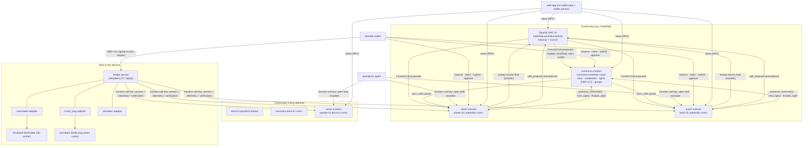
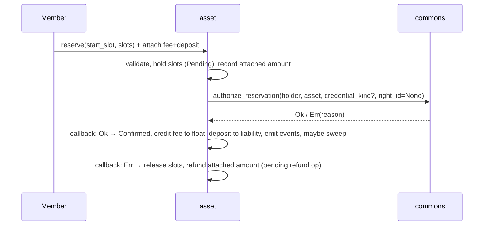

# ARCHITECTURE

## Deployment and wallet compatibility

- The deployment is NEAR testnet with emulated/simulated devices. The contracts have not had an external security audit; the bridge is trusted for physical access and telemetry, with independent human approval required for rewards.
- Cards expose NEP-171/177/181 views. `nft_transfer`, `nft_transfer_call` and `nft_approve` always reject; their argument signatures are simpler than the standard because the implementation ignores those arguments. A future deployment should preserve the standard signatures. Display in third-party wallets has not been verified.
- A granted usage right cannot be deleted, downgraded or transferred through contract methods. Usage rights retain their expiry, and DAO-controlled machine availability, group membership and credential requirements can affect whether a right can be used. Credentials can be suspended by the DAO; this does not revoke earned usage rights.
- Evidence/receipt uploads are hashed locally by the web app. Rationale and annotation strings, and optional evidence URIs supplied through the contract API, are public on chain.

## 1. System overview



`<root>` is the team's top-level testnet account (decide in research B8, e.g. `commonkit-demo.testnet`). DAO accounts are created by the Sputnik factory under `sputnikv2.testnet`.

## 2. Components and responsibilities

| Component | Owns | Never does |
| :--- | :--- | :--- |
| **Sputnik DAO** (unmodified) | Treasury, council, all governance decisions | — |
| **commons** contract (1 per community) | Role registry (mirrors DAO decisions), asset registry + groups, credential kinds, credential cards, usage-right cards (NEP-171, non-transferable), training flow | Holds community money (only storage balance) |
| **asset** contract (1 per asset, same WASM) | Profile, reservations, sessions, fees, deposits, float, sweeps, telemetry, upkeep tasks (all `UpkeepKind`s) and capped reimbursements, fault reports, service state, escalations, per-asset reputation, ledger | Mints rights itself (asks commons), stores roles of its own (receives push from commons) |
| **bridge** | NEP-413 request verification, on-chain access check, device lock/unlock through adapters, telemetry reporting, verification tests | Holds money, approves tasks |
| **agent** | Reads rule status (Metric, Schedule, Report triggers), opens rule-based upkeep tasks, escalates purchases and over-cap reimbursements, writes rationale | Approves, pays, changes profiles |
| **web** | Read-only public views (no wallet), member actions via wallet, public board | Custody, private keys |
| **sdk** | Typed client, event decoder, shared types | — |

## 3. Why two contracts

- Rights are **shared across an asset group** (earn on the printer, use on the laser) and credentials are **community-wide**. Shared, consumable state needs a single source of truth → `commons`.
- Money and device rules are **per asset** → each asset keeps its own account, float and ledger. This preserves the story "the machine has its own wallet" and gives `code_hash` equality across assets.
- Roles are decided once by the DAO in `commons` and **pushed** to registered assets so role checks in assets stay synchronous.

## 4. Key flows

### 4.1 Reserve with payment



### 4.2 Reserve with a usage right

Same as 4.1 but `right_id` is passed, no fee attached (deposit may still be required). `commons` checks holder, status `Active`, group contains asset, not expired → sets `Locked{asset, reservation_id}`. Cancel → `release_right`. Session finished → `finalize_right` (Consumed).

### 4.3 Physical access

```mermaid
sequenceDiagram
    participant M as Member (wallet)
    participant B as bridge
    participant A as asset
    participant D as device adapter
    M->>B: POST /access {reservation_id, job file?} + NEP-413 signature
    B->>B: verify signature, nonce, recipient; RPC view_access_key(account, pubkey)
    B->>A: view can_access(account, reservation_id)
    A-->>B: {ok, reason}   (reason "out_of_service" → 403, device stays locked)
    B->>A: mark_session_started(reservation_id)   (function-call key; chain first, D-404)
    B->>D: unlock / start job   (only after the chain write succeeded)
    D-->>B: job done / session timeout
    B->>D: lock
    B->>A: mark_session_finished(reservation_id, metrics)
```

### 4.4 Upkeep loop

```mermaid
sequenceDiagram
    participant B as bridge
    participant A as asset
    participant G as agent
    participant W as Worker (member)
    participant V as Verifier (member)
    participant C as commons
    B->>A: report_telemetry(cumulative metrics)
    G->>A: view get_rule_status()
    G->>A: open_upkeep_task(rule_id, rationale)  (only if the rule is due per its trigger, caps & quota ok)
    W->>A: claim_task(task_id)
    W->>A: submit_task(task_id, evidence_hash, evidence_uri, expense?, receipt_hash?)  (expense: Restock/Repair only, <= reimbursable_max)
    B->>A: submit_verification_result(task_id, passed, details_hash)
    V->>A: approve_task(task_id)  (V ≠ W, V has verifier role)
    A->>C: mint_rights(holder=W, group, count, source=task)
    C-->>A: minted token ids
    A->>A: callback: Rewarded (exactly once), reset rule baseline per trigger, reputation record + event
    A->>W: Reimbursement op (if an expense was reserved from free float; never from deposits)
```

Triggers (CONTRACT_SPEC §2.1, §3.3): **Metric** — telemetry delta since the last reward ≥ threshold; **Schedule** — `every_hours` since the last reward; **Report** — active fault reports from distinct members ≥ `min_reports`. Expenses above `council_threshold_cash` need a council second approval; above `auto_reward_cash_cap` they are paid only through a DAO proposal (`escalate(kind="reimbursement")`).

### 4.5 Sweep and escalation

- After any inflow, if `free_float > float_cap`, the asset transfers `free_float - float_cap` to the DAO (`sweep` op, pending → done/failed). Anyone can call `sweep()`.
- `escalate(kind, amount, receiver, reason)` (agent or council) → asset calls `dao.add_proposal(Transfer…)` attaching the bond from the free float → callback stores proposal id. `sync_escalation(id)` reads `dao.get_proposal` and updates status.

### 4.6 Training and credentials

All in `commons`: trainer `propose_credential(trainee, kind)` → verifier `approve_credential(id)` (≠ trainer, ≠ trainee) → mint credential card to trainee + mint `trainer_reward_rights` usage-right cards to trainer for the kind's group.

### 4.7 Faults and out of service

A member with a session on the asset in the last 14 days calls `report_fault(rule_id?, note_hash)` (one active report per member per rule; otherwise `E_NO_RECENT_SESSION` / `E_ALREADY_REPORTED`). Reports make a `Report`-trigger rule due, and the agent opens a Repair (or Rebalance) task. A steward or council member can call `set_out_of_service(true, reason_hash)`: `reserve` and `mark_session_started` then fail with `E_OUT_OF_SERVICE`, `can_access` returns `out_of_service`, and future reservations can be cancelled with a full refund. The asset returns to service when a Repair task is Rewarded or when the council (or DAO) calls `set_out_of_service(false, …)`. Each period is kept in `get_service_log` with who ended it; `verify.sh` checks every closed period (TEST_PLAN §6).

## 5. Trust boundaries

| Boundary | Trusted for | Mitigation |
| :--- | :--- | :--- |
| DAO council | Governance | Standard Sputnik voting; cannot revoke granted rights (invariant 2) |
| commons ↔ asset | Each trusts only the other's account id set at init / registration | `predecessor == commons_id` / `asset is registered` checks |
| Bridge | Telemetry truthfulness, physical lock | Telemetry only opens tasks; rewards need a human verifier; DAO can revoke operator |
| Agent | Task rationale | Can only open rule-backed tasks within caps; cannot approve or pay |
| Members | Their own actions | Self-verification forbidden |
| Physical world | — | Honest limits section; social control |

## 6. Data and evidence

- On-chain state is the source of truth for money, rights, tasks and reputation.
- Every state change emits a NEP-297 event. The web app and `verify.sh` read state via views; tx links come from the explorer API (research B16) or from `evidence/*.json` written by scripts.
- Evidence photos never go on-chain; only a SHA-256 hash and an optional URI.

## 7. Environments

| Env | Purpose |
| :--- | :--- |
| `near-workspaces` sandbox | Contract integration tests (including a real Sputnik DAO WASM if obtainable; otherwise a minimal mock DAO with the same interface — log which) |
| testnet | Everything demoed and claimed |
| local bridge + device emulators + simulator | Every demo run (no hardware is used, D-022); reproducible by judges |
| hosted web | Static deploy (Vercel or GitHub Pages) pointing at testnet RPC |
