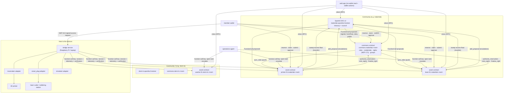
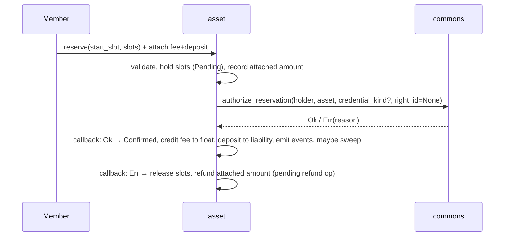
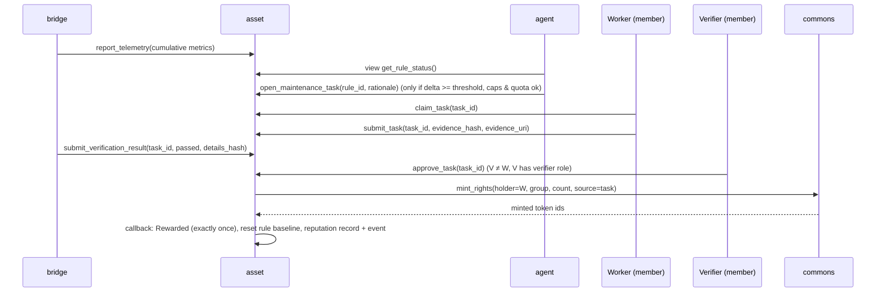

# ARCHITECTURE

## 1. System overview



`<root>` is the team's top-level testnet account (decide in research B8, e.g. `commonkit-demo.testnet`). DAO accounts are created by the Sputnik factory under `sputnikv2.testnet`.

## 2. Components and responsibilities

| Component | Owns | Never does |
| :--- | :--- | :--- |
| **Sputnik DAO** (unmodified) | Treasury, council, all governance decisions | — |
| **commons** contract (1 per community) | Role registry (mirrors DAO decisions), asset registry + groups, credential kinds, credential cards, usage-right cards (NEP-171, non-transferable), training flow | Holds community money (only storage balance) |
| **asset** contract (1 per asset, same WASM) | Profile, reservations, sessions, fees, deposits, float, sweeps, telemetry, maintenance tasks, escalations, per-asset reputation, ledger | Mints rights itself (asks commons), stores roles of its own (receives push from commons) |
| **bridge** | NEP-413 request verification, on-chain access check, device lock/unlock through adapters, telemetry reporting, verification tests | Holds money, approves tasks |
| **agent** | Reads telemetry, opens rule-based maintenance tasks, escalates purchases, writes rationale | Approves, pays, changes profiles |
| **web** | Read-only public views (no wallet), member actions via wallet, public board | Custody, private keys |
| **sdk** | Typed client, event decoder, shared types | — |

## 3. Why two contracts

- Rights are **shared across an asset group** (earn on the printer, use on the laser) and credentials are **community-wide**. Shared, consumable state needs a single source of truth → `commons`.
- Money and device rules are **per asset** → each asset keeps its own account, float and ledger. This preserves the story "the machine has its own wallet" and gives `code_hash` equality across assets.
- Roles are decided once by the DAO in `commons` and **pushed** to registered assets so role checks in assets stay synchronous.

## 4. Key flows

### 4.1 Reserve with payment



### 4.2 Reserve with a usage right

Same as 4.1 but `right_id` is passed, no fee attached (deposit may still be required). `commons` checks holder, status `Active`, group contains asset, not expired → sets `Locked{asset, reservation_id}`. Cancel → `release_right`. Session finished → `finalize_right` (Consumed).

### 4.3 Physical access

```mermaid
sequenceDiagram
    participant M as Member (wallet)
    participant B as bridge
    participant A as asset
    participant D as device adapter
    M->>B: POST /access {reservation_id, job file?} + NEP-413 signature
    B->>B: verify signature, nonce, recipient; RPC view_access_key(account, pubkey)
    B->>A: view can_access(account, reservation_id)
    A-->>B: {ok, reason}
    B->>D: unlock / start job
    B->>A: mark_session_started(reservation_id)   (function-call key)
    D-->>B: job done / session timeout
    B->>D: lock
    B->>A: mark_session_finished(reservation_id, metrics)
```

### 4.4 Maintenance loop



### 4.5 Sweep and escalation

- After any inflow, if `free_float > float_cap`, the asset transfers `free_float - float_cap` to the DAO (`sweep` op, pending → done/failed). Anyone can call `sweep()`.
- `escalate(kind, amount, receiver, reason)` (agent or council) → asset calls `dao.add_proposal(Transfer…)` attaching the bond from the free float → callback stores proposal id. `sync_escalation(id)` reads `dao.get_proposal` and updates status.

### 4.6 Training and credentials

All in `commons`: trainer `propose_credential(trainee, kind)` → verifier `approve_credential(id)` (≠ trainer, ≠ trainee) → mint credential card to trainee + mint `trainer_reward_rights` usage-right cards to trainer for the kind's group.

## 5. Trust boundaries

| Boundary | Trusted for | Mitigation |
| :--- | :--- | :--- |
| DAO council | Governance | Standard Sputnik voting; cannot revoke granted rights (invariant 2) |
| commons ↔ asset | Each trusts only the other's account id set at init / registration | `predecessor == commons_id` / `asset is registered` checks |
| Bridge | Telemetry truthfulness, physical lock | Telemetry only opens tasks; rewards need a human verifier; DAO can revoke operator |
| Agent | Task rationale | Can only open rule-backed tasks within caps; cannot approve or pay |
| Members | Their own actions | Self-verification forbidden |
| Physical world | — | Honest limits section; social control |

## 6. Data and evidence

- On-chain state is the source of truth for money, rights, tasks and reputation.
- Every state change emits a NEP-297 event. The web app and `verify.sh` read state via views; tx links come from the explorer API (research B16) or from `evidence/*.json` written by scripts.
- Evidence photos never go on-chain; only a SHA-256 hash and an optional URI.

## 7. Environments

| Env | Purpose |
| :--- | :--- |
| `near-workspaces` sandbox | Contract integration tests (including a real Sputnik DAO WASM if obtainable; otherwise a minimal mock DAO with the same interface — log which) |
| testnet | Everything demoed and claimed |
| local bridge + simulator | Reproducible judge runs without hardware |
| hosted web | Static deploy (Vercel or GitHub Pages) pointing at testnet RPC |
