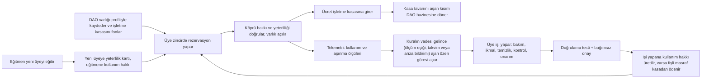

# COMMONKIT

## Kendi bakımını finanse eden ortak varlıklar.

> *"Shared things that pay for their own upkeep — and open up to the people who keep them alive."*
>
> Vitrin örneği: *"A 3D printer that pays for its own maintenance — and only prints for the people who keep it alive."*

**Ürün ve geliştirme tanımı · 9 Kasım 2026 · Sürüm 2.3**

### Neden zincir? (tek cümle)

> Bugün ortak bir makinenin parası ve kuralları tek bir yöneticinin tablosunda durur; o yönetici gidince sistem çöker. COMMONKIT'te makinenin ekonomisi, topluluğun kurallarını uygulayan ve kimsenin sahip olmadığı kendi hesabında yaşar: kimse parasını keyfi olarak çekemez, kimse kazandığın hakkı geri alamaz.
>
> *"Today a shared machine's money and rules live in one admin's spreadsheet. On COMMONKIT they live in the machine's own keyless account: no one can drain it, and no one can take back what you earned."*

Bu cümle README'nin ilk paragrafında ve videonun ilk 10 saniyesinde yer alır.

| Karar | Projenin son yönü |
| :--- | :--- |
| Hedef | **Social Money 1.liği** |
| Ana track | **Social Money** (`social`) |
| Ek tracklar | **NFTs That Do Something** (`nfts`), kullanım hakları ve yeterlilikler NEP-171 kart olarak çalışırsa. **Agent Economy** (`agents`), varlığın gerçek para kazanıp harcadığı akış uçtan uca doğrulanırsa. |
| Ürün | Topluluğa ait her ortak varlığın (makine, araç, cihaz, sunucu) kendi NEAR hesabıyla gelir topladığı, bakım ihtiyacını kendisinin bildirdiği ve onu ayakta tutanlara erişim açtığı protokol |
| Kapsam | Tek kontrat + varlık profilleri + takılabilir adaptörler. Aynı kod; makerspace, yurt, kooperatif, apartman, araştırma grubu gibi farklı topluluklarda çalışır. |
| Saklama modeli | **Ana saklama Sputnik DAO hazinesinde.** Varlık hesabı yalnız tavanlı bir işletme kasası tutar; fazlası otomatik olarak DAO'ya döner. |
| Vitrin varlığı | Bir üretici topluluğunun ortak 3D yazıcısı (Klipper/Moonraker veya OctoPrint) |
| Demoda kanıtlanacak genellik | Aynı kontratın dört testnet varlığında (yazıcı, lazer, çamaşır makinesi, buzdolabı) ve iki DAO'da çalışması; hepsi simülasyon (D-022) |
| Gerçek kullanıcı | Planlanmadı (D-022); pilot sayısı iddia edilmez |
| Ayırt edici mekanizma | Varlık, zincirdeki hakkı olmayana açılmaz; telemetrisiyle bakım görevi açar; doğrulanmış bakım ve eğitim emeği, o varlığı kullanma hakkına dönüşür. |
| Ajan modeli | Varlık başına tek bir operasyon ajanı; yalnız function-call anahtarı ve kontratın koyduğu sınırlar içinde çalışır |
| Mevcut durum | Ürün yönü kararlaştırıldı. Bu belge henüz geliştirilmiş veya test edilmiş işlev iddiası taşımaz. |

---

## 0. Sürüm geçmişi

### 1.0 → 2.0: varlık ekonomik aktör olur

| Sürüm 1.0 | Sürüm 2.0 | Neden |
| :--- | :--- | :--- |
| Topluluk ortak kaynağı yönetir | **Varlığın kendisi** ekonomik aktördür | "Neden zincir?" sorusuna somut cevap |
| Bakımı yalnız insanlar onaylar | Telemetri + doğrulama testi + bağımsız insan onayı | Tek kişinin beyanına dayanmaktan çıkar |
| Erişim bir rezervasyon kaydıdır | Erişim **fiziksel olarak** uygulanır | Jürinin göreceği an: rezervasyon → makine çalışır |
| Üç ajan türü | Varlık başına tek gerçek ajan | Süs yerine gerçek rol |
| Trezu entegrasyonu | Kapsam dışı; Sputnik doğrudan | Barındırılan Trezu akışı testnette denenemiyor |
| NEP-141 demo token | Testnet NEAR | Daha az hareketli parça |

### 2.0 → 2.1: tek araçtan protokole

| Sürüm 2.0 | Sürüm 2.1 | Neden |
| :--- | :--- | :--- |
| Yazıcıya özel kontrat | **Varlık profili + adaptör** mimarisi | Farklı gerçek dünya senaryolarına hitap |
| Tek kullanım birimi | Zaman, döngü, kWh, km, iş, GPU saati | Her varlık farklı bir şey satar |
| Tek entegrasyon yolu | Dört seviye: manuel, akıllı priz, yerel API, akıllı kilit | Telemetrisiz varlıklar da katılır |
| Yalnız bakım hak üretir | Bakım **ve** eğitim; **yeterlilik kartları** | İtibara dayalı erişimin en somut hali |
| Tek varlığa bağlı haklar | **Varlık grupları** | Topluluk içinde hak geçişi |
| Demo tek varlık | Üç varlık, iki DAO | Genellik çalışırken gösterilir |

### 2.1 → 2.2: 1.lik için açıkların kapatılması

| Açık | Sürüm 2.2'deki çözüm | Bölüm |
| :--- | :--- | :--- |
| Track saklamanın mevcut hazinede olmasını istiyor; ücretler varlık kontratında birikiyordu | **Kasa modeli:** varlık hesabı tavanlı işletme kasası tutar, fazlası DAO'ya döner; ödül tablosunun üstü Sputnik önerisi olur | 6 |
| İş modeli ve sürdürülebilirlik yoktu | **İş modeli bölümü:** COMMONKIT kiti, DAO'nun açıp kapatabildiği protokol payı, hedef segmentler, açık kaynak sürdürülebilirlik | 14 |
| Gerçek kullanıcı yoktu | **Pilot topluluk planı:** asgari hedefler, onay ve gizlilik kuralları, ölçülecek sonuçlar | 13 |
| İtibar kayıtları işleme bağlı değildi | Her kayıt görev/oturum kimliği taşır ve NEP-297 olayı yayınlar; pano her satırı işlem bağlantısına çevirir | 9, 11 |
| Trezu kullanılmıyordu | README'de açıklama paragrafı ve Sputnik uyumluluğu | 17 |
| Tasarım belirsizdi | **Tasarım yönü** ve ayrı tasarım günü | 12, 22 |
| "Neden zincir?" dağınıktı | Tek cümle; belgenin, README'nin ve videonun başında | Üst bölüm |
| Jüri sorularına hazırlık yoktu | **Jüri soruları ve cevapları** + track uyum tablosu | 17, 19 |

### 2.2 → 2.3: bakımdan özene (upkeep)

> *"Fix it, refill it, clean it, check it, teach it — every kind of care that keeps a shared thing alive earns access to it."*
> Onar, doldur, temizle, kontrol et, öğret: ortak bir şeyi yaşatan her özen, ona erişim kazandırır.

| Sürüm 2.2 | Sürüm 2.3 | Neden |
| :--- | :--- | :--- |
| Yalnız bakım görevi (`MaintenanceRule`) | **Özen kuralı** (`UpkeepRule`): tür (bakım, ikmal, temizlik, kontrol, onarım, yerine getirme, gözetim) × tetik (ölçüm eşiği, takvim, arıza bildirimi) | Gerçek ortak varlıkların çoğu bakımdan çok ikmal, temizlik ve kontrol ister |
| Görev yalnız telemetri eşiğiyle açılır | Ölçüm eşiği (`Metric`), takvim (`Schedule every_hours`) veya arıza bildirimi (`Report min_reports`) | Telemetrisi olmayan veya takvimle bakılan varlıklar da katılır |
| Sarf malzemesi parası tanımsızdı | İkmal ve onarımda fişle, tavanlı (`reimbursable_max`) geri ödeme; yalnız serbest kasadan, depozitodan asla; eşiğin üstü konsey, otomatik tavanın üstü DAO önerisi | Malzemeyi cebinden alan üye zarar etmez; para kuralı zincirde kalır |
| Arıza bildirimi yoktu | Son 14 günde varlığı kullanmış üye arıza bildirir; sorumlu/konsey varlığı **hizmet dışı** yapar (rezervasyon ve erişim durur, ileri rezervasyonlar tam iadeyle iptal edilir); ödüllendirilmiş onarım görevi veya konsey kararı hizmete döndürür | Bozuk makineye rezervasyon satılmaz; dönüş izlenebilir |
| 8 profil, 18 adımlık jüri akışı | 12 profil (4 yeni "yalnız profil örneği" + simülatör senaryosu), 21 adım | Genellik daha geniş gösterilir; vitrin hikâyesi (yazıcı nozul bakımı) değişmez |

Kaynak: `docs/DECISIONS.md` D-017, `docs/CONTRACT_SPEC.md` §2.1, §2.4a, §3.3.

**2.3 notu (D-022):** Donanım alınmayacak ve pilot yapılmayacak; tüm varlıklar simülasyondur (gerçek adaptörler, API'ye sadık cihaz emülatörlerine karşı çalışır). Bölüm 3, 13, 15 ve 20 buna göre güncellendi.

---

## 1. Ürün bir cümlede

**COMMONKIT, topluluğa ait her ortak varlığa kendi NEAR hesabını verir: varlık kullanım ücretleriyle kendi bakımını finanse eder, bakıma ihtiyaç duyduğunda görevi kendisi açar ve onu ayakta tutan üyelere kendini kullanma hakkı verir.**

Topluluğun insan üyeleri kuralları, bütçeyi, eğitmenleri ve doğrulayıcıları belirler. Topluluğun parası Sputnik DAO hazinesinde durur; varlık hesabı yalnız günlük işletme için tavanlı bir kasa tutar ve anahtarsızdır. Varlığa erişim, zincirdeki rezervasyon, kullanım hakları ve gerekiyorsa yeterlilik kartlarına bağlıdır. Operasyon ajanı varlığın verisini okur ve kontratın izin verdiği sınırlar içinde bakım görevi açar.

Aynı kontrat; bir makerspace'in 3D yazıcısında, bir yurdun çamaşır makinesinde, bir köy kooperatifinin traktöründe ve bir araştırma grubunun GPU sunucusunda yalnız **varlık profili** ve **adaptör** değiştirilerek çalışır.

## 2. Çözdüğümüz sorun: ortak malların trajedisi, gündelik ölçekte

Bir topluluğun ortak kullandığı her şey benzer bir döngüye girer:

- Herkes kullanır, kimse bakım yapmak istemez.
- Bakım yapan kişinin emeği görünmez kalır; birkaç gönüllü tükenir.
- Sarf ve bakım giderleri bir yöneticinin cebinden veya dağınık bağışlardan karşılanır.
- Kimin ne zaman kullanacağı mesaj gruplarında kararlaştırılır; kurala uymayanı durduracak bir mekanizma yoktur.
- Riskli makineleri eğitimsiz kişilerin kullanmasını engelleyen şey, birinin orada olup olmamasıdır.
- Varlık bozulana kadar kimse bakım ihtiyacını fark etmez.

Bu döngü makerspace'teki yazıcıda, yurttaki çamaşır makinesinde, apartmanın ortak şarj noktasında, kooperatifin traktöründe ve laboratuvarın ortak sunucusunda aynıdır. Mevcut ekipman kütüphanesi ve rezervasyon yazılımları takvimi yönetir; ama varlığın ekonomisi (gelir, bakım fonu, bakım yapanın karşılığı, erişim kuralı) hâlâ bir yöneticinin elindedir ve o yönetici gittiğinde sistem çöker.

**Temel değer önerisi:** Ortak varlık kendi bakımını finanse eder; onu ayakta tutan emek otomatik olarak o varlığa erişim hakkına dönüşür.

## 3. Gerçek dünya senaryoları

Her senaryo aynı döngüyü kullanır: **kullan → öde → varlık özenini finanse eder → varlık özen ister (bakım, ikmal, temizlik, kontrol, onarım…) → üye yapar → doğrulanır → hak kazanır → kullanır.** Değişen yalnız varlık profili ve adaptördür. Özen türleri ve tetikler `profiles/*.json` dosyalarından alınmıştır (ayrıntı: `docs/PROFILES.md`).

| # | Senaryo | Topluluk | Varlık | Kullanım birimi | Erişim kilidi | Telemetri | Özen işleri (tür: tetik) | Özel kural | Durum |
| :--- | :--- | :--- | :--- | :--- | :--- | :--- | :--- | :--- | :--- |
| 1 | **Makerspace yazıcısı** (vitrin) | Üniversite maker kulübü, hackerspace | 3D yazıcı | Baskı işi | Moonraker / OctoPrint API | Baskı süresi, iş sayısı, kullanılan filament (mm) | Bakım: nozul temizliği (baskı süresi), yatak kalibrasyonu (iş sayısı) · İkmal: filament makarası (filament mm; fişle en çok 0,5 NEAR) · Onarım: arıza bildirimi | Kalibrasyon baskısı doğrulamaya eklenir | simülasyon (testnet varlığı, emüle Moonraker) |
| 2 | **Riskli atölye makinesi** | Makerspace, okul atölyesi | Lazer kesici, CNC | Oturum | Akıllı priz / röle | Çalışma süresi, enerji | Bakım: lens ve ayna temizliği (çalışma süresi) · Kontrol: aylık güvenlik kontrolü (takvim) · **yeni üyeleri eğitmek** (yeterlilik akışı) | Yeterlilik kartı olmadan erişim yok | simülasyon (testnet varlığı, emüle Shelly) |
| 3 | **Yurt / apartman çamaşırhanesi** | Öğrenci yurdu, site yönetimi | Çamaşır makinesi | Yıkama döngüsü | Simülatör (hedef: akıllı priz) | Döngü sayısı | Temizlik: filtre (30 döngü) · Bakım: kireç sökme (120 döngü) · İkmal: ortak deterjan (40 döngü; fişle en çok 0,3 NEAR) · Onarım: arıza bildirimi | Arıza bildirilince hizmet dışı; onarım ödüllenince hizmete döner | simülasyon (testnet varlığı) |
| 4 | **Ortak EV şarj noktası** | Site, kooperatif ofis | Şarj noktası | kWh (v1'de dilim başına ücret) | OCPP uzaktan başlatma | Oturum sayısı | Kontrol: kablo ve soket (100 oturum) | Bakım fonu elektrik maliyetinden ayrı | yalnız profil örneği (simülatör senaryosu) |
| 5 | **Topluluk bisikleti** | Mahalle girişimi, kampüs | Kargo bisikleti | Km (v1'de dilim başına ücret) | Akıllı kilit | Km | Kontrol: fren (300 km), lastik (500 km) · Yerine getirme: iki üye bildirince bisikleti yerine götürmek | Depozito, sorunsuz iade geçmişine göre düşer | yalnız profil örneği (simülatör senaryosu) |
| 6 | **Ortak GPU / sunucu** | Araştırma grubu, hackerspace, açık kaynak topluluğu | GPU sunucusu | GPU saati | API anahtarı ağ geçidi | GPU saati | Bakım: sürücü güncelleme (30 günde bir, takvim) · Temizlik: toz filtresi ve fanlar (1000 GPU saati) | Dijital görevler otomatik testle doğrulanır; `gpu_basics` yeterliliği | yalnız profil örneği (simülatör senaryosu) |
| 7 | **Tarım kooperatifi** | Köy kooperatifi, üretici birliği | Traktör ve sulama pompası | Saat | Akıllı röle | Motor süresi | Bakım: yağ değişimi (100 motor saati) · Temizlik: pompa filtresi (14 günde bir, takvim) | `tractor_operator` yeterliliği | yalnız profil örneği (simülatör senaryosu) |
| 8 | **Okul / kütüphane ekipmanı** | Okul kulübü, halk kütüphanesi | Mikroskop | Ödünç alma | Manuel QR teslim | Yok (kullanım sayısı) | Temizlik: optik temizliği ve envanter (20 ödünç) | Telemetrisiz varlıklar da katılır | yalnız profil örneği (simülatör senaryosu) |
| 9 | **Mahalle buzdolabı** | Mahalle dayanışma ağı | Ortak buzdolabı | Ziyaret (ücretsiz) | Akıllı priz (izleme) | Sıcaklık (zincire 8 °C üstü örnek sayısı olarak gider) | Temizlik: haftalık temizlik (168 saatte bir, takvim) · Kontrol: sıcaklık sapmasında conta ve termostat | Ücret yok; 0,1 NEAR iade edilen depozito (D-020) | simülasyon (testnet varlığı, D-018) |
| 10 | **Acil durum jeneratörü** | Apartman bloğu, afet gönüllüleri | Jeneratör | Saat | Akıllı priz / röle | Yakıt seviyesi (zincire kullanılan yakıt olarak gider) | Kontrol: aylık yük altında test (takvim) · İkmal: yakıt (20 l; fişle en çok 1 NEAR) | `generator_operator` yeterliliği | yalnız profil örneği (simülatör senaryosu) |
| 11 | **Prova odası** | Müzik kolektifi | Prova odası | Seans | Akıllı kilit | Seans sayısı | Temizlik: oda ve kablolar (10 seans) · Gözetim: haftalık açık oda akşamı (takvim) · Onarım: iki üye arıza bildirince | Arıza için iki bağımsız bildirim | yalnız profil örneği (simülatör senaryosu) |
| 12 | **Alet kütüphanesi** | Mahalle alet kütüphanesi | Merdiven | Ödünç alma | Manuel QR teslim | Kullanım sayısı | Kontrol: basamak, ayak ve kilitler (25 ödünç) | Güvenlik kontrolü ödünç sayısına bağlı | yalnız profil örneği (simülatör senaryosu) |

Demoda yalnız 15. bölümde belirtilen senaryolar çalışır halde gösterilir. Diğerleri README'de "yalnız profil örneği" olarak etiketlenir ve tamamlanmış özellik olarak iddia edilmez.

Bu senaryolar birbirini tamamlar: farklı kullanım birimleri, farklı entegrasyon seviyeleri, farklı özen türleri (bakım, ikmal, temizlik, kontrol, onarım, yerine getirme, gözetim, eğitim, dijital bakım), farklı tetikler (ölçüm eşiği, takvim, arıza bildirimi), farklı topluluklar ve kampüsten kırsala farklı coğrafyalar.

## 4. Ana döngü

Bir özen görevinin karşılığı, görev açılırken bellidir. Görevin açılması, tamamlanması, doğrulanması ve hakkın üretilmesi ayrı durumlar olarak izlenir.

## 5. Varlık profili

Her varlık, DAO önerisiyle kaydedilen bir **profil** taşır. Kontrat kodu aynıdır; davranış profilden gelir.

| Profil alanı | Örnek (yazıcı) | Örnek (çamaşır makinesi) | Örnek (lazer kesici) |
| :--- | :--- | :--- | :--- |
| `asset_type` | `printer_3d` | `washer` | `laser_cutter` |
| `usage_unit` | `job` | `cycle` | `session_minutes` |
| `price_per_unit` | 0,5 NEAR | 0,2 NEAR | 0,1 NEAR / 10 dk |
| `deposit` | 2 NEAR | 0 | 3 NEAR |
| `float_cap` | 3 NEAR | 1 NEAR | 3 NEAR |
| `auto_reward_cap` | 1 NEAR veya 3 hak | 0,3 NEAR veya 5 hak | 1 NEAR veya 3 hak |
| `period_reward_quota` | 10 hak / ay | 20 hak / ay | 8 hak / ay |
| `telemetry_metrics` | baskı saati, nozul saati, hata oranı | döngü sayısı, enerji | çalışma saati |
| `maintenance_rules` | 200 nozul saatinde temizlik | 30 döngüde filtre | 40 saatte lens temizliği |
| `verification` | kalibrasyon baskısı + 1 bağımsız onay | 1 bağımsız onay | test kesimi + 1 bağımsız onay |
| `required_credential` | yok | yok | `laser_safety` |
| `asset_group` | `makerlab-fab` | `dorm-b-laundry` | `makerlab-fab` |
| `adapter` | `moonraker` | `smart_plug` | `smart_plug` |
| `protocol_fee_bps` | 0 (pilot) | 0 (pilot) | 0 (pilot) |

Profil değişiklikleri DAO önerisiyle yapılır ve verilmiş hakları geriye dönük değiştirmez.

## 6. Varlık hesabı, kasa modeli, köprü ve adaptörler

### Kasa modeli: saklama DAO'da

Topluluğun parası Sputnik DAO hazinesinde durur. Varlık hesabı yalnız üç şey tutar:

| Varlık hesabındaki para | Ne için | Sınır |
| :--- | :--- | :--- |
| **Depozitolar** | Kullanıcıya ait iade alacağı | Kullanıcı başına profildeki tutar; gelir sayılmaz, tavana dahil değildir |
| **Ayrılmış görev ödülleri** | Açık bakım görevlerinin nakit kısmı | Görev başına `auto_reward_cap` |
| **Serbest işletme kasası** | Küçük sarf ve parça giderleri, öneri teminatları | `float_cap` |

Kasa kuralları:

- Ücret gelirinden sonra serbest kasa `float_cap`'i aşarsa, fazlası **oturum kapanışında otomatik olarak DAO hesabına** aktarılır. Ayrıca herkesin çağırabileceği `sweep()` metodu aynı aktarımı yapar.
- Kasa azaldığında DAO, `fund_float` önerisiyle yeniden fonlar.
- `auto_reward_cap`'i aşan nakit ödül veya parça alımı kontrat içinde ödenemez. Kontrat, kendi kasasından öneri teminatını ekleyerek DAO'ya bir **Sputnik önerisi** açar; ödemeyi DAO yapar.
- Bakım ödüllerinin çoğu nakit değil **kullanım hakkıdır**. Hak üretimi para gerektirmez, yalnız `period_reward_quota` ile sınırlıdır. Bu yüzden varlık hesabında az para durur.

Bu model, trackin "saklama ve onaylar mevcut DAO hazinesinde" şartını karşılarken "makinenin kendi cüzdanı" hikâyesini korur: makine yalnız gündelik işletme için cüzdan taşır, birikimi topluluğun hazinesine gider.

### Varlık hesabı

Her varlık, kendi NEAR alt hesabında çalışan bir COMMONKIT kontratıdır. Örnekler: `printer-01.makerlab.testnet`, `laser-01.makerlab.testnet`, `washer-01.dorm-b.testnet`.

- Hesapta **full-access anahtar yoktur**. Kontrat deploy edildikten sonra anahtar silinir; bu durum zincirden doğrulanabilir.
- Varlığın yöneticisi topluluğun Sputnik DAO'sudur. Profil, roller ve anahtar iptalleri yalnız DAO hesabından gelen çağrılarla değişir.
- Roller (kaynak sorumlusu, doğrulayıcı, eğitmen, konsey) DAO önerisiyle kontrata yazılır; DAO tek doğruluk kaynağıdır.
- DAO politikası, varlık kontratına öneri ekleme izni verir.
- Aynı WASM her yeni varlık için yeni alt hesaba deploy edilir. "Bir varlık, bir hesap."

### Köprü

Köprü, varlığın yanında (ör. bir Raspberry Pi üzerinde) çalışan küçük bir servistir. Bir köprü birden fazla varlığa hizmet edebilir.

| Görev | Nasıl |
| :--- | :--- |
| Kimlik | Kullanıcı erişim isterken cüzdanıyla imzalı bir mesaj (NEP-413) gönderir. Köprü imzayı ve hesabı doğrular. |
| Erişim kontrolü | Köprü kontrata `can_access(account, reservation_id)` view çağrısı yapar; rezervasyon, hak ve yeterlilik birlikte kontrol edilir. |
| Açma / başlatma | Geçerliyse adaptör üzerinden varlığı açar ve `mark_session_started` çağırır. |
| Telemetri | Adaptörden okunan ölçüleri `report_telemetry` ile kontrata yazar. |
| Doğrulama testi | Bakım sonrası profildeki testi çalıştırır (kalibrasyon baskısı, test kesimi, test döngüsü); sonucu kanıta ekler. |

Köprünün zincirdeki yetkisi yalnız bir **function-call anahtarıdır**: `mark_session_started`, `mark_session_finished`, `report_telemetry`, `submit_verification_result`. Bu anahtar para transferi yapamaz ve çağrıya NEAR ekleyemez.

### Adaptörler ve entegrasyon seviyeleri

| Seviye | Adaptör | Erişim kilidi | Telemetri | Uygun senaryolar |
| :--- | :--- | :--- | :--- | :--- |
| 0 | `manual_qr` | Sorumlunun QR ile teslim onayı | Yok; kullanım sayısı | Mikroskop, kamera, el aletleri |
| 1 | `smart_plug` (Shelly, Tasmota vb.) | Elektriği açma/kapama | Enerji ve güç profili | Çamaşır makinesi, lazer, lehim istasyonu, kompresör |
| 2 | `moonraker`, `octoprint`, `ocpp`, `api_gateway` | Cihazın kendi API'si | Cihaza özgü ayrıntılı ölçüler | 3D yazıcı, EV şarj noktası, GPU sunucusu |
| 3 | `smart_lock` | Fiziksel kilit | Konum, km, batarya | Bisiklet, dolap, depo |
| — | `simulator` | Sanal | Senaryo dosyasından üretilen ölçüler | Jüri testi; donanımsız tüm senaryolar |

**Seviye 1 akıllı priz adaptörü** genelliğin anahtarıdır: elektrikle çalışan neredeyse her ortak cihaz, cihaza hiç dokunmadan sisteme katılabilir.

Adaptör arayüzü sabittir: `lock()`, `unlock(session)`, `read_metrics()`, `run_verification(test)`. Yeni bir varlık türü eklemek, kontrata değil yalnız yeni bir adaptöre kod yazmayı gerektirir.

### Güven sınırı

Köprü ve adaptörler güvenilen bileşenlerdir. Bu nedenle:

- Telemetri tek başına ödül üretmez; yalnız görev açar.
- Ödül için bağımsız bir insan onayı her zaman gerekir.
- Köprü anahtarı DAO tarafından iptal edilebilir.
- Fiziksel olarak varlığın başındaki biri kilidi atlatabilir. Bu bir sosyal kontrol sorunudur ve açıkça yazılır.

## 7. Örnek kullanıcı hikâyeleri

Tutarlar yalnız demo ekonomisini açıklamak içindir. Testnet NEAR'ın gerçek değeri yoktur.

### Vitrin: makerspace yazıcısı

| Adım | Eylem | Görünen sonuç |
| :--- | :--- | :--- |
| 1 | DAO, `printer-01` varlığını profiliyle kaydeden ve işletme kasasına 3 NEAR aktaran öneriyi oylar. | Sputnik'te geçmiş öneri; kasada 3 NEAR, DAO hazinesinde kalan bakiye. |
| 2 | Ali bir baskı dilimi ayırır: 0,5 NEAR ücret + 2 NEAR depozito. | Ücret kasaya, depozito ayrı alacak olarak kaydedilir. |
| 3 | Ali dosyasını imzalı mesajla gönderir. | Köprü hakkı doğrular; gerçek yazıcı basmaya başlar. |
| 4 | Rezervasyonu olmayan Can aynı anda iş gönderir. | Köprü reddeder; yazıcı basmaz. |
| 5 | Baskı biter; kaynak sorumlusu teslimi onaylar. | Ali'nin depozitosu iade edilir. Kasa tavanı aşıldığı için 0,5 NEAR DAO hazinesine döner. |
| 6 | Telemetri nozul saati eşiğini aşar. | Ajan, gerekçesiyle birlikte 2 kullanım hakkı karşılıklı bakım görevi açar. |
| 7 | Ayşe görevi üstlenir, nozulu temizler ve yatağı kalibre eder. | Kanıt (fotoğraf özeti) eklenir; köprü kalibrasyon baskısını çalıştırır. |
| 8 | Bağımsız doğrulayıcı Mehmet onaylar. | Ayşe'ye 2 kullanım hakkı üretilir; itibar kaydı görev kimliğiyle yazılır; telemetri sayacı sıfırlanır. |
| 9 | Ayşe bir hakla rezervasyon yapar. | Hak tüketilir; yazıcı Ayşe'nin işini basar. |
| 10 | Ajan, yeni nozul için 4 NEAR'lık parça alımı ister. | Tavan üstü olduğu için kontrat DAO'ya Sputnik önerisi açar; konsey oylar, ödemeyi DAO yapar. |
| 11 | Bir konsey üyesi, Ayşe'nin kalan hakkını silmeye çalışır. | Kontrat reddeder: verilmiş hak geriye dönük silinemez. |

### İkinci varlık: yeterlilik isteyen lazer kesici

| Adım | Eylem | Görünen sonuç |
| :--- | :--- | :--- |
| 1 | Zeynep lazer kesici için rezervasyon yapmaya çalışır. | Kontrat reddeder: `laser_safety` yeterlilik kartı yok. |
| 2 | DAO'nun yetkili eğitmeni Ayşe, Zeynep'e güvenlik eğitimi verir. | Eğitim kaydı açılır. |
| 3 | Bağımsız bir üye eğitimi onaylar. | Zeynep'e devredilemez `laser_safety` kartı; Ayşe'ye eğitim karşılığı 1 lazer kullanım hakkı. |
| 4 | Zeynep rezervasyon yapar. | Köprü akıllı prizi açar; lazer çalışır. Oturum bitince priz kapanır. |
| 5 | Ayşe, yazıcıdan kazandığı hakkı aynı `makerlab-fab` grubundaki lazerde kullanır. | Hak grup içinde geçer; grup dışı bir varlıkta reddedilir. |

### Üçüncü senaryo (simülasyonla): yurt çamaşırhanesi

Aynı kontrat `washer-01.dorm-b.testnet` hesabına, farklı bir DAO ve farklı profille deploy edilir. Simülasyon adaptörü 30 döngüyü hızlandırılmış olarak üretir; ajan filtre temizliği görevi açar; bir öğrenci temizler, oda temsilcisi onaylar, öğrenci 3 ücretsiz yıkama hakkı kazanır. Demo bu senaryonun simülasyon olduğunu ekranda açıkça etiketler.

## 8. Operasyon ajanı

Her varlığın tek bir operasyon ajanı vardır. Ajan, varlık adına çalışır; kendi oy hakkı veya üyeliği yoktur. Aynı ajan kodu, profildeki bakım kurallarını okuyarak her varlık türünde çalışır.

| Yapabilir | Yapamaz |
| :--- | :--- |
| Telemetri ve kullanım kayıtlarını okumak | Bakımın yapıldığını onaylamak |
| Profildeki eşik aşılınca gerekçeli bakım görevi açmak | `auto_reward_cap` veya `period_reward_quota`'yı aşmak |
| Tavan üstü bir ihtiyaç için `escalate` çağırmak; kontrat DAO'ya öneri açar | DAO hazinesinden doğrudan para çekmek |
| Açık görev kuyruğunu ve geciken bakımları izlemek | Kendi açtığı görevi kapatmak veya ödülü serbest bırakmak |
| Eşikler tutarlı biçimde yanlışsa DAO'ya profil değişikliği **önermek** | Profili kendisi değiştirmek |

Ajanın zincir yetkisi bir function-call anahtarıdır: yalnız `open_maintenance_task`, `annotate_task` ve `escalate` metotları. Ajan sınırı aşan bir görev açmayı denerse işlem reddedilir; demo bunu gösterir.

Ajanın gerekçesi görev kaydına yazılır. AI çıktısı bir öneri ve gerekçedir; para kurallarını kontrat uygular. DAO, ajanın anahtarını tek öneriyle iptal edebilir.

**GPU senaryosunda (6)** dijital bakım görevleri otomatik testle doğrulanabildiği için başka bir üyenin ajanı da görevi üstlenip hak kazanabilir. Bu akış uçtan uca çalışmadıkça Agent Economy işlevi olarak sunulmaz.

## 9. Para, depozito, haklar, yeterlilikler ve itibar

### Para

- İlk demo NEAR testnetinde, testnet NEAR ile çalışır.
- Ana saklama DAO hazinesindedir; varlık hesabı 6. bölümdeki kasa modeline uyar.
- Ayrılmış görev parası başka göreve kullanılamaz.
- `protocol_fee_bps` pilotta 0'dır; DAO açıp kapatabilir (bkz. 14. bölüm).

### Depozito

- Depozito kullanıcı alacağıdır; gelir sayılmaz ve kasaya karışmaz.
- Teslim onaylanınca iade edilir.
- Hasar iddiasında tutar inceleme durumuna alınır; kesinti yalnız bağımsız inceleme sonucuyla yapılır.

### Kullanım hakkı

- Belirli bir varlık veya **varlık grubu** için, profildeki kullanım biriminde, süresi ve miktarı belli bir erişim hakkıdır.
- **NEP-171 uyumlu, devredilemez erişim kartı** olarak temsil edilir: cüzdanlarda görünür, transfer metodu reddeder. (NFTs trackine giriş bu kartın çalışmasına bağlıdır; çalışmazsa haklar kontrat kaydı olarak kalır.)
- Yeni hak üretimi `period_reward_quota` ile sınırlıdır; varlığın kapasitesi aşılmaz.
- Aynı hak eşzamanlı iki rezervasyonda kullanılamaz.
- İptal halinde hakkın geri dönme koşulu önceden tanımlıdır.
- **Verilmiş bir hak, yönetici işlemiyle geriye dönük silinemez.**

### Yeterlilik kartı

- Riskli varlıklar profilde bir yeterlilik ister (ör. `laser_safety`, `cnc_basic`, `tractor_operator`).
- Kartı yalnız DAO'nun yetkilendirdiği eğitmen önerir; bağımsız bir üye onaylar.
- Kart devredilemez ve süreli olabilir.
- DAO, güvenlik ihlalinde kartı askıya alabilir; bu ileriye dönük bir işlemdir ve gerekçesi kaydedilir.
- Eğitim vermek, eğitmene profildeki karşılığı kadar kullanım hakkı kazandırır.

### İtibar: her puan izlenebilir

- İtibar, adlandırılmış hesaba ve varlığa bağlı sade bir kayıttır: tamamlanan oturumlar, sorunsuz teslimler, doğrulanmış bakımlar, verilen eğitimler. Evrensel bir puan yoktur.
- **Her itibar kaydı, onu doğuran oturum, görev veya eğitim kimliğini taşır** ve NEP-297 standardında bir olay yayınlar.
- Pano, her kaydı olayın geldiği işleme bağlar. Bir kişinin itibarındaki her satır tıklanınca zincirdeki işleme gider.
- Kullanılan itibar kuralı: profildeki sayıda sorunsuz teslimi olan üyeden daha düşük depozito istenir.

## 10. Yönetim ve doğrulama

| Rol | Yetki |
| :--- | :--- |
| Üye | Rezervasyon yapmak, bakım görevi üstlenmek, kanıt sunmak |
| Kaynak sorumlusu | Teslimi onaylamak, varlık durumunu bildirmek |
| Bakım doğrulayıcısı | Bakım kanıtını incelemek ve onaylamak (kendi işini onaylayamaz) |
| Eğitmen | Yeterlilik eğitimi vermek ve kart önermek |
| Konsey | Orta kademe onaylar |
| DAO | Varlık kaydı, profil, kasa fonlama, roller, ajan ve köprü anahtarları, büyük ödemeler |
| Köprü | Erişim kontrolü, telemetri, doğrulama testi sonucu |
| Operasyon ajanı | Sınırlar içinde bakım görevi açmak ve tavan üstü ihtiyacı DAO'ya taşımak |

Onay kademeleri:

| Kademe | Koşul | Onay | Ödemeyi yapan |
| :--- | :--- | :--- | :--- |
| 1. Otomatik | Ödül `auto_reward_cap` altında; doğrulama testi geçti | Bir bağımsız doğrulayıcı | Varlık kontratı (hak veya kasadan nakit) |
| 2. Konsey | Ödül tavan altında ama profildeki "konsey eşiği" üstünde, ya da üyenin ilk bakımı | Bağımsız doğrulayıcı + bir konsey üyesi | Varlık kontratı |
| 3. DAO | Tavan üstü nakit, parça alımı, istisnai veya ihtilaflı işlem | Sputnik önerisi, normal DAO oylaması | DAO hazinesi |

Kademe eşikleri profil parametresidir.

## 11. NEAR üzerinde mimari

### Hesaplar

| Hesap | Rol | Anahtar modeli |
| :--- | :--- | :--- |
| `makerlab.sputnikv2.testnet` | Makerspace topluluğunun hazinesi ve konseyi (değiştirilmemiş Sputnik v2) | Sputnik politikası |
| `dorm-b.sputnikv2.testnet` | Yurt topluluğunun hazinesi (üçüncü senaryo) | Sputnik politikası |
| `printer-01.makerlab.testnet` | Yazıcının varlık kontratı | Anahtarsız |
| `laser-01.makerlab.testnet` | Lazer kesicinin varlık kontratı | Anahtarsız |
| `washer-01.dorm-b.testnet` | Çamaşır makinesinin varlık kontratı | Anahtarsız |
| `bridge-01.makerlab.testnet` | Makerspace köprüsü | Varlık kontratlarında yalnız köprü metotlarına function-call anahtarı |
| `agent-01.makerlab.testnet` | Operasyon ajanı | Yalnız ajan metotlarına function-call anahtarı |
| Üye hesapları | Rezervasyon, ödeme, kanıt, onay | Kullanıcı cüzdanı |

Yeterlilik kartları topluluk düzeyinde tutulur: bir topluluğun tüm varlıkları aynı kart kaydını okur.

### DAO bağlantısı

- Varlık kaydı, profil ve kasa fonlama, Sputnik'te `FunctionCall` önerisiyle yapılır.
- Kasa fazlası, düz transferle DAO hesabına döner.
- Tavan üstü ödemeler için varlık kontratı, teminatını kendi kasasından ekleyerek DAO'ya `Transfer` önerisi açar.
- Profil değişiklikleri, rol atamaları, ajan ve köprü anahtarlarının iptali de DAO önerisiyle yapılır.
- COMMONKIT yeni multisig geliştirmez; ana hazineye hiçbir transfer yetkisi almaz.
- Farklı topluluklar farklı DAO'larla aynı kontrat kodunu kullanır.

### Bileşenler

| Bileşen | Sorumluluk |
| :--- | :--- |
| Varlık kontratı (Rust, near-sdk) | Profil, rezervasyon, kasa ve süpürme, depozito, görev, hak kartı, itibar kayıtları, NEP-297 olayları |
| Yeterlilik kaydı | Topluluk düzeyinde yeterlilik kartları |
| Köprü | NEP-413 imza doğrulama, `can_access`, adaptör çağrıları, telemetri |
| Adaptörler | `manual_qr`, `smart_plug`, `moonraker`, `simulator` (demo); `octoprint`, `ocpp`, `smart_lock`, `api_gateway` (sonraki adım) |
| Operasyon ajanı | Profil kurallarına göre telemetri analizi, gerekçeli görev açma, tavan üstü taşıma |
| Olay okuyucu | NEP-297 olaylarını okuyup panodaki her satırı işlem bağlantısına çevirir |
| Web uygulaması | Topluluklar, varlıklar, pano, rezervasyon, görevler, haklarım, bütçe, onaylar |
| `verify.sh`, `simulate.sh` | Jüri ve AI tarayıcı için anahtarsız doğrulama ve donanımsız senaryo çalıştırma |

### İşlem doğruluğu

- İade, süpürme ve ödül ödemeleri için bekleyen / başarılı / başarısız durumları vardır.
- Yalnız callback sonucu finansal durumu kesinleştirir.
- Başarısız transfer alacağı silmez; yeniden deneme ikinci ödeme üretmez.
- Başarısız süpürme kasada kalır ve sonraki çağrıda yeniden denenir.
- Rezervasyon ve hak tüketimi eşzamanlı taleplere karşı korunur.

## 12. Ekranlar ve tasarım

### Ana ekranlar

| Ekran | Kullanıcının gördüğü ve yaptığı |
| :--- | :--- |
| Topluluklar | Topluluğun varlıkları, kasa durumları ve kuralları |
| Varlık | Canlı durum, telemetri, bakım göstergesi, uygun dilimler, gerekli yeterlilik, rezervasyon |
| **Pano** (herkese açık) | Açık görevler, üstlenenler, verilen haklar ve ödemeler, kişi bazlı kayıtlar; her satır işleme bağlı |
| Bakım | Görev ayrıntısı, ajanın gerekçesi, ödül, kanıt gönderimi |
| Eğitimler | Eğitim istekleri, eğitmenler, onay bekleyenler |
| Haklarım | Erişim kartları, yeterlilik kartları, geçerlilik, kullanım geçmişi |
| Bütçe | DAO hazinesi, varlık kasaları, süpürmeler, ayrılmış görev parası, depozito yükümlülükleri |
| Onaylar | Teslim, bakım, eğitim ve kademe onayları |
| Ajan | Yetkiler, sınırlar, açtığı görevler, iptal durumu |
| Kanıt | Her işlemin zincir bağlantısı, DAO önerileri, anahtarsız hesap ve `code_hash` kontrolü |

Topluluk, varlık, pano ve kanıt sayfaları cüzdan gerektirmeden açılır.

### Tasarım yönü

- **Varlık bir karakterdir.** Her varlık sayfası bir "makine kartı" gibi açılır: adı, hesabı, canlı durumu, bakım göstergesi ve "beni kim ayakta tutuyor" listesi. Kullanıcı bir tabloya değil, bir makineye bakar.
- **Bakım göstergesi tek bakışta okunur:** bir sonraki bakıma kalan kullanım, kasadaki para ve açık görev.
- **Mobil önce.** Rezervasyon ve kanıt gönderimi telefondan, atölyenin içinde yapılır.
- **Zincir görünür ama gürültü değil.** Her önemli satırda küçük bir işlem bağlantısı; ayrıntı "Kanıt" ekranında.
- **Simülasyon açıkça farklı görünür.** Simülasyon varlıkları belirgin bir etiket ve farklı bir renk tonuyla gösterilir.
- Videonun her karesi bu ekranlardan gelir; ayrı sunum slaydı kullanılmaz.

## 13. Pilot topluluk

**Durum: planlanmadı (D-022).** Donanım alınmayacak; hackathon süresince gerçek bir topluluk pilotu yapılmayacak ve README'de pilot sayısı iddia edilmeyecek. Gerçek kullanıcı kanıtı yerine, herkesin çalıştırabildiği emülasyon gösterilir: köprünün gerçek adaptörleri, API'ye sadık cihaz emülatörlerine karşı çalışır ve her olay "simulated" etiketi taşır.

İnsan ileride isterse pilot yalnız `manual_qr` adaptörüyle, elektroniği olmayan gerçek bir eşya üzerinde yapılır. O durumda `docs/PILOT.md`'deki onay metni ve kurallar geçerlidir: katılımcı onayı alınır, kişisel bilgi zincire yazılmaz, testnet tokenlarının değeri olmadığı söylenir, gerçekleşen sayılar aynen yazılır.

## 14. İş modeli ve sürdürülebilirlik

### Kim öder, ne için öder

| Gelir kaynağı | Ne | Kim öder | Durum |
| :--- | :--- | :--- | :--- |
| **COMMONKIT kiti** | Hazır köprü cihazı (ör. Raspberry Pi), bir veya birkaç akıllı priz, kurulum betiği | Topluluk, bir kez | Pilot sonrası |
| **Protokol payı** | Ücretlerden küçük bir oran (`protocol_fee_bps`) | Varlık kullanıcıları | Pilotta 0; DAO açıp kapatabilir, tavanı kontratta sabit |
| **Barındırılan hizmet** | Birden çok topluluğu ve varlığı yöneten barındırılan arayüz, ağ ücreti sponsorluğu, bildirimler | Büyük topluluklar, kurumlar | Fikir aşaması |

Bu modellerin hiçbiri henüz doğrulanmamıştır; pilot sonrası denenir.

### Hedef segmentler ve sıra

1. **Makerspace ve üniversite kulüpleri:** Teknik olarak hazır, ekipmanı API'li, erken benimseyen topluluklar. Pilot burada.
2. **Yurtlar, siteler, ortak kullanım alanları:** Akıllı priz seviyesiyle çamaşırhane, kompresör, ortak mutfak cihazları.
3. **Kooperatifler ve paylaşılan ekipman:** Tarım makineleri, soğuk hava depoları; daha yüksek değerli varlıklar, daha yüksek etki.
4. **Dijital ortak varlıklar:** Araştırma gruplarının ve açık kaynak topluluklarının ortak GPU sunucuları.

### Protokolün kendisinin sürdürülebilirliği

- Kontratlar anahtarsız ve açık kaynaktır. COMMONKIT ekibi ortadan kalksa bile mevcut varlıklar çalışmaya, haklar geçerli olmaya devam eder.
- Her topluluk aynı WASM'i kendi DAO'suyla deploy edebilir; merkezi bir sunucuya bağımlılık yoktur.
- Kritik iade ve hak işlemleri arayüz olmadan komut satırından da yapılabilir.

### Varlığın kendi sürdürülebilirliği

Profil, ücretin bakım ve sarf giderlerini karşılayacak düzeyde ayarlanır. Pano, her varlık için "kasa kaç bakım dönemi daha yeter" göstergesini hesaplar. Kasa sürekli azalıyorsa ajan DAO'ya fiyat değişikliği önerir.

## 15. Jüriye gösterilecek demo

### Demoda gerçekten çalışacak senaryolar

Fiziksel cihaz yok (D-022). Zincir tarafı (rezervasyon, kasa, DAO önerileri, haklar) gerçek testnet işlemleridir; cihazlar emüle veya simüledir ve her yerde öyle etiketlenir.

| Senaryo | Varlık | Adaptör | Durum |
| :--- | :--- | :--- | :--- |
| 1 | 3D yazıcı (`printer-01`) | `moonraker` → emüle Moonraker | Simülasyon (testnet varlığı) |
| 2 | Lazer kesici (`laser-01`) | `smart_plug` → emüle Shelly | Simülasyon (testnet varlığı), yeterlilik kartıyla |
| 3 | Yurt çamaşır makinesi (`washer-01`) | `simulator` | Simülasyon (testnet varlığı), ikinci DAO |
| 4 | Yurt buzdolabı (`fridge-01`) | `simulator` | Simülasyon (testnet varlığı), takvimli temizlik |

Diğer sekiz profil README'de "yalnız profil örneği (simülatör senaryosu)" olarak verilir ve `simulate.sh` ile denenebilir.

### 90 saniyelik video

Yalnız ekran kaydı: web uygulaması, "SIMULATED" etiketli köprü/emülatör konsolu ve explorer sekmeleri. Kamera çekimi, gerçek cihaz veya "yazıcı basmaya başlar" görüntüsü yok; simüle her çekimde "simulated" altyazısı var. Ayrıntılı zamanlama: `docs/DEMO_SCRIPT.md` §1.

1. **0–10 sn:** Neden zincir cümlesi; panoda dört varlık kartı, SIMULATED rozetiyle.
2. **10–25 sn:** Web uygulamasından rezervasyon → köprü konsolunda emüle yazıcı işi başlatır. Rezervasyonu olmayanın isteği reddedilir.
3. **25–40 sn:** Telemetri eşiği → ajan görevi açar, gerekçe ekranda. Ayşe görevi üstlenir, emülatörde kalibrasyon baskısı, Mehmet onaylar → 2 hak kartı.
4. **40–45 sn:** Özen montajı: doldur · temizle · kontrol et · öğret.
5. **45–58 sn:** Zeynep lazere erişemez → Ayşe onu eğitir → kart gelir, emüle priz açılır.
6. **58–68 sn:** Kasa tavanı aşılır → fazlası DAO hazinesine akar. Parça alımı için DAO önerisi.
7. **68–77 sn:** Aynı kontrat, başka bir toplulukta: yurt çamaşırhanesi. "Same contract. Different commons."
8. **77–83 sn:** Konsey verilmiş hakkı silmeye çalışır → kontrat reddeder.
9. **83–90 sn:** `verify.sh` çıktısı + depo ve demo bağlantıları.

### Tam jüri akışı (README'de "X yap → Y'yi gör" olarak)

1. DAO önerisi ile yazıcı kaydı, profil ve kasa fonlama.
2. Rezervasyon: ücret kasaya, depozito ayrı alacak olarak.
3. Köprü erişim kontrolü: geçerli hakla emüle yazıcıda baskı başlar, haksız iş reddedilir.
4. Teslim onayı ve depozito iadesi (gerçek testnet transferi).
5. Kasa tavanı aşımı → DAO hazinesine süpürme.
6. Telemetri eşiği → ajanın gerekçeli bakım görevi.
7. Bakım, kalibrasyon sonucu, bağımsız onay → hak kartı ve izlenebilir itibar kaydı.
8. Hak kartıyla rezervasyon ve baskı.
9. Tavan üstü parça alımı → kontratın açtığı Sputnik önerisi → DAO ödemesi.
10. Yeterliliği olmayan üyenin lazer rezervasyonu → red.
11. Eğitim, onay, yeterlilik kartı ve eğitmen ödülü → lazer açılır.
12. Hakkın varlık grubu içinde kullanılması; grup dışında reddi.
13. Aynı kontratın ikinci DAO'da, çamaşır makinesi profiliyle simülasyonda çalışması.
14. Ajan kota üstü görev açmayı dener → red.
15. Aynı bakım için ikinci ödül talebi → red.
16. Kendi işini onaylama girişimi → red.
17. Verilmiş hakkı silme girişimi → red.
18. Yazıcıda filament yenileme (Restock): fişli masraf tavan dahilinde geri ödenir; tavan üstü masraf reddedilir.
19. Çamaşır makinesinde arıza bildirimi → servis dışı → ileri rezervasyonlara tam iade → onarım görevi ödüllenir → servise dönüş (simülasyon).
20. Buzdolabında zamanlı temizlik: aralık dolmadan görev açılamaz, dolunca açılır (simülasyon).
21. Hesap uzlaştırması: DAO hazineleri, varlık kasaları, süpürmeler, depozito yükümlülükleri, geri ödeme tavanları, servis dışı dönemleri, hak ve yeterlilik kartları.

## 16. Tamamlanma ölçütleri

| Alan | Tamamlanmış sayılma koşulu |
| :--- | :--- |
| DAO | Değiştirilmemiş Sputnik v2 testnet DAO'larında geçmiş önerilerle varlık kaydı ve kasa fonlama |
| Saklama | Kasa tavanı uygulanır; fazlası DAO'ya döner; tavan üstü ödeme yalnız DAO önerisiyle olur |
| Varlık hesabı | Kontrat hesaplarında full-access anahtar yok; `verify.sh` gösterir |
| Genellik | Aynı WASM üç varlıkta, iki DAO'da, üç profil ve üç adaptörle çalışır; `code_hash` eşitliği gösterilir |
| Fiziksel erişim | Gerçek yazıcı ve akıllı priz yalnız geçerli hak ve yeterlilikle açılır; video ve köprü günlüğü |
| Rezervasyon | Aynı dilim iki kişiye verilemez |
| Finans | Kasa, depozito ve görev parası karışmaz; uzlaştırma tutar |
| Bakım | Telemetri → görev → kanıt → doğrulama testi → bağımsız onay → tek seferlik ödül |
| Eğitim | Eğitmen önerisi → bağımsız onay → yeterlilik kartı + eğitmen ödülü |
| Haklar | Üretim, tüketim, grup içi kullanım, grup dışı red, transfer reddi, geriye dönük silme reddi |
| İtibar | Her kayıt bir olaya ve işleme bağlanır; panodan tıklanarak doğrulanır |
| Ajan | Gerçek telemetriyle görev açar; kota, tavan, iptal ve taşıma denenir |
| Hata akışları | Başarısız transfer ve süpürme, yeniden deneme, çift ödül, kendi işini onaylama |
| Pilot | 13. bölümdeki gerçekleşen sayılar, işlem bağlantılarıyla README'de |
| Testler | Kontrat birim testleri + testnet uçtan uca senaryolar + negatif testler + adaptör arayüz testleri |
| Denenebilirlik | Temiz kurulum, cüzdansız demo, her senaryo için simülasyon profili, işlem bağlantıları |

Köprünün **simülasyon modu** zorunludur: jüri veya AI tarayıcı donanım olmadan da tüm senaryoları çalıştırabilmelidir.

## 17. Track gereksinimleri uyum tablosu

Bu tablo README'ye aynen girer.

| Social Money gereksinimi | COMMONKIT'te nasıl karşılanıyor | Doğrulama |
| :--- | :--- | :--- |
| Ortak bütçeler | DAO hazinesi + varlık başına tavanlı işletme kasası | Bütçe ekranı, uzlaştırma adımı |
| Programlanabilir ödüller | Telemetriyle açılan, doğrulanınca bir kez hak üreten bakım ve eğitim görevleri | Jüri akışı 6–7, 11, 15 |
| Ortak sahiplik | DAO'ya ait, anahtarsız varlık hesapları | `verify.sh` |
| İtibara dayalı erişim | Yeterlilik kartları; teslim geçmişine göre depozito | Jüri akışı 10–11 |
| Mevcut DAO'yu saklama ve onay için kullanmak | Ana saklama ve büyük ödemeler Sputnik'te; kasa fazlası DAO'ya döner | Jüri akışı 5, 9 |
| Multisig'i yeniden yazmamak | Değiştirilmemiş Sputnik v2 kullanılır | DAO hesaplarının kodu fabrika kodudur |
| Adlandırılmış hesaplar | Her varlığın ve topluluğun adlı hesabı | Hesap tablosu |
| Her itibar puanı izlenebilir | Her kayıt bir NEP-297 olayına ve işleme bağlı | Pano |
| Kademeli onay | Otomatik / konsey / DAO kademeleri | Bölüm 10 |
| Herkese açık pano | Cüzdansız pano: görevler, üstlenenler, haklar, ödemeler, kişi kayıtları | Barındırılan demo |

### Trezu hakkında README paragrafı

> COMMONKIT, Trezu'nun kullandığı Sputnik DAO kontratını değiştirmeden kullanır. Varlık kontratlarının açtığı öneriler standart Sputnik önerileridir; bu nedenle Trezu gibi Sputnik tabanlı hazine arayüzlerinde görünmeleri ve oylanmaları beklenir. Barındırılan Trezu uygulaması bu hackathon süresince testnette denenemediği için Trezu ile uçtan uca entegrasyon bu sürümde iddia edilmez.

## 18. Rakiplerden ayrışma

İncelenen Social Money başvurularının büyük çoğunluğu nakit ödeme, bütçe kuralı veya akran puanı üzerine kurulu ve hiçbiri fiziksel bir varlığı kontrol etmiyor.

| Örnek | Kapsamı | COMMONKIT'in farkı |
| :--- | :--- | :--- |
| Petty Cash | Sputnik DAO için kurallı harcama bütçeleri | Bütçe bir varlığın bakımına bağlı; ödül nakit değil erişim |
| Hat Tip, FairShare | Akran puanıyla DAO ödemesi | Görevi kimse uydurmuyor; varlık telemetrisiyle açılıyor |
| Mandate | Quadratic topluluk bütçesi | Tek seferlik bütçe kararı değil, süregelen kullanım-bakım ekonomisi |
| Pull Up | Etkinlik depozitosu | Depozito, sürekli kullanılan ve fiziksel olarak kilitlenen bir varlığa bağlı |
| LisDao | DAO oyuyla görev yapan ajan | Ajan varlığın kendi işletmecisi; sınırlarını kontrat koyuyor |
| myTurn, Lend Engine | Zincir dışı ekipman kütüphanesi yazılımı | Ekonomi ve erişim kuralı yöneticiye değil, anahtarsız hesaba bağlı |

Bu karşılaştırma, ilk ürün olunduğunu kanıtlamaz. Ayrışma, çalışan akış ve gerçek topluluk kullanımıyla gösterilecektir.

## 19. Jüri hazırlığı

### AI taraması (Claude Code ve Codex)

- README'nin başında neden zincir cümlesi, ürün, sorun ve "X yap → Y'yi gör" adımları. Pazarlama dili yok.
- Her iddianın yanında zincir bağlantısı veya test adı.
- Senaryo tablosunda her satır için durum: **gerçek donanım**, **simülasyon**, **yalnız profil örneği**.
- `verify.sh`: anahtarsız; varlık hesaplarında full-access anahtar olmadığını, tüm varlıkların aynı `code_hash`'i taşıdığını, DAO önerilerinin kasa fonlamalarıyla ve süpürmelerle eşleştiğini, depozito ve hak uzlaştırmasını kontrol eder.
- `simulate.sh <senaryo>`: herhangi bir senaryoyu donanımsız uçtan uca çalıştırır.
- Barındırılan, cüzdansız demo; en az 18 Kasım'a, tercihen 25 Kasım'a kadar açık.
- Kullanılan kütüphane ve şablonlar listelenir; LICENSE dosyası (MIT).
- "Dürüst sınırlar" bölümü.

### İnsan jüri: muhtemel sorular ve hazır cevaplar

Sorular, jüri üyelerinin bilinen ilgi alanlarından yapılmış çıkarımlardır.

| Soru | Cevap (en fazla iki cümle) |
| :--- | :--- |
| **Bu neden bir veritabanıyla yapılamaz?** | Veritabanında makinenin parası ve kuralları bir yöneticinin elindedir; o gidince sistem çöker. Burada para anahtarsız bir hesapta, kurallar DAO'nun kontrolünde ve verilen hak kimse tarafından geri alınamaz. |
| **NEAR'ın hangi özelliği fark yaratıyor?** | Her varlığın kendi adlı hesabı, yalnız belirli metotları çağırabilen function-call anahtarlarıyla sınırlanmış köprü ve ajan, değiştirilmemiş Sputnik DAO ve kontratların açtığı DAO önerileri. |
| **Telemetriyi köprü uydurursa ne olur?** | Telemetri yalnız görev açar, ödül üretmez; ödül için her zaman bağımsız bir insan onayı gerekir ve köprü anahtarı DAO tarafından iptal edilebilir. |
| **Bunu kim kullanıyor?** | [Pilot topluluk adı], [N] gerçek üye, [N] oturum, [N] doğrulanmış bakım; hepsi README'de işlem bağlantılarıyla. |
| **Bu bir iş mi?** | Hazır köprü kiti ve DAO'nun açabildiği küçük bir protokol payı; ilk segment makerspace'ler, sonra yurtlar, siteler ve kooperatifler. Model henüz doğrulanmadı, pilot sonrası denenecek. |
| **Bakım ödülü makinenin ekonomisini batırmaz mı?** | Ödüller çoğunlukla nakit değil kullanım hakkıdır, dönem kotası ve kapasiteyle sınırlıdır; büyük nakit ödemeler DAO oylamasına gider. |
| **Makine gerçekten otonom mu?** | Kendi hesabı, kendi kasası, kendi bakım talebi ve kendi erişim kontrolü var; insanlar yalnız kuralları koyar ve işi doğrular. |
| **Ölçeklenir mi?** | Aynı WASM üç varlıkta ve iki DAO'da çalışıyor; akıllı priz adaptörü elektrikle çalışan neredeyse her cihazı cihaza dokunmadan sisteme katar. |
| **Neden Trezu yok?** | Sputnik'i değiştirmeden kullanıyoruz; önerilerimiz standart Sputnik önerileri. Barındırılan Trezu testnette denenemediği için entegrasyon iddia etmiyoruz. |

## 20. Dürüst sınırlar

- **Köprü ve adaptörler güvenilir bileşenlerdir.** Telemetri tek başına ödül üretmez; köprü anahtarı DAO tarafından iptal edilebilir.
- **Fiziksel cihaz test edilmedi (D-022).** Adaptörler yalnız belgelenmiş API alt kümesini uygulayan cihaz emülatörlerine karşı test edildi; gerçek bir Moonraker, Shelly veya Tasmota cihazında çalıştırılmadı. Tüm varlıklar simülasyondur.
- **Fiziksel atlatma mümkündür.** Gerçek kurulumda varlığın başındaki biri kilidi atlatabilir. Bu sosyal kontrol gerektirir.
- **Akıllı priz telemetrisi dolaylıdır.** Döngü ve çalışma saati enerji profilinden çıkarılır; hatalı sayım olabilir.
- **Bakım ve eğitim kalitesi** için insan değerlendirmesi gerekir; doğrulama testi destekleyici kanıttır.
- **Yeterlilik kartı yasal sertifika değildir.** Topluluğun iç kuralıdır; iş güvenliği mevzuatının yerini tutmaz.
- **Üyelik:** Bir hesap, tekil insan kanıtı değildir. Roller DAO tarafından yönetilir.
- **Mülkiyet:** Zincirdeki haklar fiziksel varlığın hukuki mülkiyetini devretmez.
- **Gizlilik:** Kanıt fotoğrafları zincire yazılmaz; yalnız özetleri kaydedilir.
- **Yalnız testnet.** Testnet NEAR'ın değeri yoktur.
- **Trezu ile uçtan uca entegrasyon yok.**
- **Senaryoların çoğu gösterilmedi.** Dört testnet varlığı simülasyondur; diğer sekiz profil yalnız profil örneği ve simülatör senaryosudur.
- **İş modeli doğrulanmadı.** Gerçek kullanıcı pilotu yapılmadı.
- **Denetim yok.** Kontrat bağımsız güvenlik denetiminden geçmemiştir.

## 21. Açık kararlar

İlk topluluklarla birlikte belirlenecek:

- Her profilde ücret, depozito, `float_cap`, `auto_reward_cap`, kota ve kademe eşikleri.
- Telemetri eşikleri ve bakım görevlerinin ödül tablosu.
- Yeterlilik türleri, eğitmen seçimi ve kart süreleri.
- Varlık gruplarının sınırları.
- Doğrulayıcıların seçimi ve çıkar çatışması kuralları.
- Kontrat sürüm geçişlerinde mevcut hakların korunması.
- Protokol payının açılıp açılmayacağı ve tavanı.
- Pilot sonrası ağ ücretlerini kimin karşılayacağı.

## 22. Teslim bağlamı ve zaman planı

Son teslim **14 Kasım 2026, 23:59 UTC** (Türkiye saatiyle **15 Kasım 2026, 02:59**). Sonuçlar 18 Kasım'a kadar açıklanır.

Teslimde: çalışan prototip, herkese açık depo, `@NEARProtocol` ve `#NEARHackathon` etiketli, videolu X demo gönderisi (isteğe bağlı olarak `@NearLegion` ve `@NearBuilders`). Testnet projeleri uygundur. Gönderimden önce güncel kurallar yeniden okunur.

| Gün | Hedef |
| :--- | :--- |
| **9 Kasım** | Pilot topluluk ve donanım kesinleşir; katılımcı onayları istenir. Kontrat iskeleti, profil, kasa modeli. |
| **10 Kasım** | Kontrat: rezervasyon, depozito, kasa süpürmesi, görev, hak ve yeterlilik kartları, itibar olayları, Sputnik öneri açma; birim ve negatif testler. İki testnet DAO. Köprü iskeleti, adaptör arayüzü, `simulator`. |
| **11 Kasım** | `moonraker` ve `smart_plug` adaptörleri gerçek donanımla; ajan; üç varlığın deploy'u; anahtar silme; `verify.sh`, `simulate.sh`. |
| **12 Kasım** | **Tasarım günü:** varlık kartı, pano, mobil rezervasyon, kanıt ekranı; cüzdansız okuma; barındırma. |
| **13 Kasım** | **Pilot günü:** gerçek üyelerle oturumlar, bakım ve eğitim; çekim; pilot verisinin README'ye işlenmesi. |
| **14 Kasım** | README (uyum tablosu, Trezu paragrafı, jüri akışı, dürüst sınırlar), 90 saniyelik video, X gönderisi; başvuru TR saatiyle akşam. |

**Gönderimde seçilecek tracklar:** `social`; hak ve yeterlilik kartları NEP-171 olarak çalışıyorsa `nfts`; varlığın para kazanıp harcadığı ajan akışı uçtan uca doğrulandıysa `agents`.

## 23. Kaynaklar

### Resmî hackathon kaynakları

- [NEAR Hackathon ana sayfası](https://nearhackathon.com/)
- [Güncel hackathon kuralları (HACKATHON.md)](https://nearhackathon.com/HACKATHON.md)
- [Social Money track rehberi](https://github.com/nearai/near-hackathon-prompt-examples/blob/main/tracks/12-social.md)
- [NFTs That Do Something track rehberi](https://github.com/nearai/near-hackathon-prompt-examples/blob/main/tracks/10-nfts.md)
- [Agent Economy track rehberi](https://github.com/nearai/near-hackathon-prompt-examples/blob/main/tracks/07-agents.md)

### Teknik kaynaklar

- [Sputnik DAO kontratı](https://github.com/near-daos/sputnik-dao-contract)
- [Trezu](https://github.com/NEAR-DevHub/trezu) · [Trezu dokümanları](https://github.com/NEAR-DevHub/trezu-docs)
- [NEAR erişim anahtarları](https://docs.near.org/protocol/accounts-contracts/access-keys)
- [NEAR kontratlar arası çağrılar](https://docs.near.org/smart-contracts/anatomy/crosscontract)
- [Moonraker API](https://moonraker.readthedocs.io/)
- [OctoPrint REST API](https://docs.octoprint.org/en/master/api/)
- NEP-171 (NFT), NEP-297 (olaylar), NEP-413 (imzalı mesaj), akıllı priz yerel API'leri (Shelly, Tasmota) ve OCPP: geliştirme sırasında güncel dokümanları doğrulanacak.

### İncelenen rakip başvurular

- [Petty Cash](https://github.com/kasbsquall/petty-cash)
- [Hat Tip](https://github.com/replaycourt/hat-tip)
- [FairShare](https://github.com/fairshare54/fairshare)
- [Mandate](https://github.com/HarshitLalwani21/mandate-near)
- [Pull Up](https://github.com/Benito3262/pull-up)
- [LisDao](https://github.com/kaizen-builds/lisdao)
- [AllTogether](https://github.com/aarash-mohsin/alltogether-near)

### Zincir dışı benzerler

- [myTurn](https://myturn.com/)
- [Lend Engine](https://www.lend-engine.com/)

---

**Temel ürün kararı:** Her ortak varlığa kendi hesabını ver. Varlık kendi bakımını finanse etsin, ihtiyacını kendisi bildirsin ve onu ayakta tutanlara kendini açsın. Topluluğun parası topluluğun hazinesinde kalsın; makine yalnız gündelik işletme kasasını taşısın. Aynı kontrat, farklı topluluklarda, farklı varlıklarda, yalnız profil ve adaptör değiştirilerek çalışsın. İnsanlar kuralları koyar ve işi doğrular; para ve erişim kurallarını kontrat uygular.
