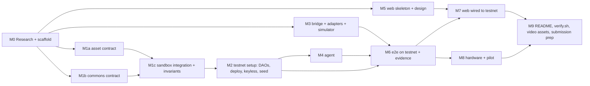

# TASKS — build plan (target: core done in ~36 hours, polish after)

Work in parallel wherever the graph allows. Each milestone ends with: tests green, `docs/STATUS.md` updated, commit, short note to the human.

Suggested subagent assignment (see `.claude/agents/`): `researcher` (M0), `contract-engineer` (M1a, M1b, M1c), `chain-ops` (M2, M6), `bridge-engineer` (M3), `agent-engineer` (M4), `frontend-engineer` (M5, M7), `verifier` (reviews every milestone), `docs-writer` (M9).

---

## M0 — Research + scaffold (≤ 2 h)

- [ ] Complete `docs/RESEARCH_CHECKLIST.md`; write `docs/RESEARCH_RESULTS.md`; log decisions.
- [ ] Ask the human once for hardware facts (E10) and pilot community name; record. Continue with simulator if unknown.
- [ ] Monorepo scaffold: pnpm workspaces, `contracts/` cargo workspace, `packages/sdk`, `bridge`, `agent`, `web`, `scripts`, `profiles`, `scenarios`, `deployments`, `evidence`.
- [ ] Tooling: rustfmt, clippy, eslint, prettier, vitest, GitHub Actions CI.
- [ ] `.gitignore` covers `.env*`, keys, `target/`, `node_modules/`, `bridge/state/`.
- [ ] `LICENSE` (MIT), `docs/STATUS.md`, `docs/DECISIONS.md` initialized.
- [ ] 8 profile JSONs in `profiles/` (printer_3d, laser_cutter, washer, ev_charger, cargo_bike, gpu_server, tractor, microscope) validated by a JSON schema shared with the contract's `validate_profile` rules.

**Accept:** CI green on an empty build; research results committed.

## M1a — asset contract (parallel with M1b)

- [ ] State, profile validation, governance methods.
- [ ] Reservations (incl. async authorize + callback), cancel, sessions, no-show, return, dispute.
- [ ] Ledger, ops, sweep, retry.
- [ ] Telemetry, rules, tasks, reward procedure, quota/period.
- [ ] Escalations (with research C8 result or fallback).
- [ ] Reputation + log.
- [ ] Events, views, error codes.
- [ ] Unit tests per method.

## M1b — commons contract

- [ ] Asset registry, groups, roles + push sync, credential kinds.
- [ ] Authorize/release/finalize rights, idempotent mint.
- [ ] Trainings and credentials.
- [ ] NEP-171/177/181 views, non-transferable guards, metadata + inline SVG media.
- [ ] Unit tests.

## M1c — sandbox integration + invariants

- [ ] Sandbox harness with real Sputnik WASM (or mock + log).
- [ ] All `inv_*` tests from TEST_PLAN §2.
- [ ] Coverage map `contracts/tests/COVERAGE.md`.
- [ ] Gas measurements → constants → DECISIONS.

**Accept:** `pnpm test:contracts` green; reproducible build hashes printed.

## M2 — testnet setup (scripts, idempotent)

- [ ] `scripts/setup-testnet.ts`: root + community accounts, member accounts (team/pilot/demo-bot), bridge & agent accounts, DAOs via factory, deploy commons + 3 assets, delete full-access keys, add function-call keys for bridge/agent per asset, write `deployments/testnet.json`.
- [ ] `scripts/seed-testnet.ts`: via DAO proposals (`proposeAndPass`): register assets, roles, credential kinds, fund storage & floats, set operators. Evidence logged.
- [ ] `scripts/verify.sh` first version (keyless, code hashes, wiring).

**Accept:** verify.sh green for wiring; DAO proposals visible with links.

## M3 — bridge + adapters + simulator (parallel from M0)

- [ ] Fastify server, config, NEP-413 challenge/verify with test vectors.
- [ ] Adapter interface + `simulator`, `smart_plug` (shelly_gen2/gen1/tasmota), `moonraker`, `octoprint`, `manual_qr`.
- [ ] Session manager, telemetry loop, verification runner, SSE events, evidence log.
- [ ] Unit tests with fake devices; recorded power traces for cycle detection.

## M4 — agent

- [ ] Loop, rule evaluation, template rationale, optional NEAR AI Cloud polish with validation.
- [ ] Escalation hints, sync, limits demo script.
- [ ] Tests.

## M5 — web skeleton + design (parallel from M0)

- [ ] Design direction, tokens, components (asset card, gauge, ledger bar, task row, card tile, proof row, SIMULATED badge).
- [ ] Routes with mocked sdk data.

## M6 — testnet e2e + evidence

- [ ] `scripts/demo/step-01..18.ts` per DEMO_SCRIPT, simulator for hardware steps.
- [ ] `pnpm demo:all` green; `evidence/steps.json` + `EVIDENCE.md`.
- [ ] `scripts/simulate.sh washer|printer|laser`.
- [ ] verify.sh full version green.

**Accept:** all 18 steps with tx hashes; verify.sh green.

## M7 — web wired to testnet + hosting

- [ ] Real data on all routes; wallet actions; bridge SSE when on LAN.
- [ ] `/proof` page mirrors verify.sh.
- [ ] Deploy (Vercel/GitHub Pages); URL in README; keep alive until at least 2026-11-25.

## M8 — hardware + pilot (needs the human on site)

- [ ] Printer via moonraker/octoprint: reserve → access → print → finish → telemetry.
- [ ] Smart plug device (soldering station or lamp stand-in for the laser if needed — label it).
- [ ] Pilot per `docs/PILOT.md`: ≥ 5 real members, ≥ 10 sessions, ≥ 1 maintenance, ≥ 1 training; evidence and consent recorded.
- [ ] Video footage per DEMO_SCRIPT §1.

## M9 — README, submission prep

- [ ] README per `docs/SUBMISSION.md` (only verified claims; status column for scenarios).
- [ ] Track compliance table, Trezu paragraph, honest limits, pilot results with links.
- [ ] X post draft + submission payload draft (do **not** post/submit — hard stop).
- [ ] Final verifier pass: fresh clone → install → tests → verify.sh → simulate.sh.

## Final acceptance (all must be ✅)

- [ ] All CLAUDE.md §4 invariants have passing tests.
- [ ] `pnpm test:contracts && pnpm test` green on a clean clone.
- [ ] verify.sh green on testnet.
- [ ] 18/18 evidence steps with tx hashes.
- [ ] Three demo assets live on the hosted web app; simulator clearly labelled.
- [ ] Real printer run on video; pilot numbers in README (whatever they really are).
- [ ] README reviewed by `verifier` agent: every claim has a link or test name.
- [ ] Submission payload and X post text ready for the human.
